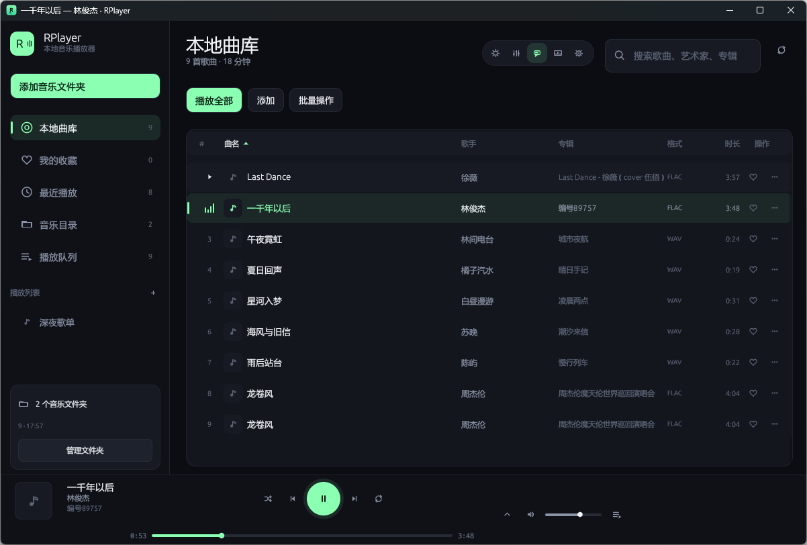
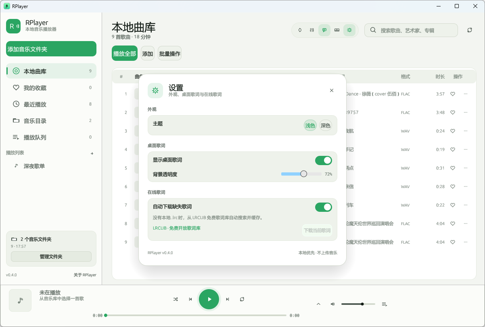

# RPlayer

RPlayer 是一个用 **Rust** 编写的本地桌面音乐播放器。它不依赖账号、云服务或网页技术栈，启动即用：选择音乐文件夹，扫描标签与封面，然后在清爽的浅色或深色界面里听歌。

v0.4 把界面进一步向 **LPlayer** 的浅色布局靠拢，并以浅色作为默认主题：白色曲库卡片、绿色强调色、顶部工具组和更轻的层次。同时加入桌面歌词透明度调节，以及从 **LRCLIB** 免费歌词库自动下载歌词。








## 特性

- **本地音乐扫描**：递归扫描文件夹，支持常见音频格式，自动读取标题、艺术家、专辑、流派、年份、音轨号与时长。
- **封面读取**：优先读取音频内嵌封面，在播放栏与正在播放页展示。
- **音乐库管理**：按标题、艺术家、专辑或时长排序；支持关键词搜索；表格展示格式与快捷操作。
- **我的收藏 / 最近播放**：点歌曲右侧的心形即可收藏，最近播放自动记录最近 100 首，均可作为独立视图浏览。
- **批量操作**：进入批量模式后勾选歌曲，可批量加入歌单，或从当前歌单/收藏中移除。
- **浅色默认 / 深色可选**：首次启动为浅色纸张主题，图标或 `Ctrl + T` 秒切，标题栏、弹窗、播放栏与自绘控件同步换色；主题会记住。
- **LPlayer 风格曲库**：白色圆角曲库卡片、顶部工具组、绿色主按钮与轻量表格行，浅色下更接近 LPlayer 的信息层次。
- **全屏正在播放**：按 `F` 或点播放栏的展开按钮，进入带环境光背景、大封面、歌词与侧边队列的沉浸视图。
- **本地歌词 + 在线歌词**：优先读取同名 `.lrc` 或内嵌歌词；没有本地歌词时，自动从 [LRCLIB](https://lrclib.net) 免费歌词库搜索并缓存，也支持右键或播放页手动重新下载。
- **桌面歌词**：独立置顶歌词条，显示上一行 / 当前行 / 下一行，可拖动、可关闭；设置中可调 35%–100% 的歌词条透明度，右键也能快速调。
- **迷你播放器**：独立置顶小窗，封面、标题、进度、播放/暂停、上下曲、收藏与展开主窗口一应俱全。
- **10 段均衡器**：31 Hz–16 kHz 实时调节，带前级、平直/流行/摇滚/爵士/低音/人声/古典/电子预设；关闭时完全旁路。
- **播放列表**：创建、重命名、删除播放列表；右键歌曲即可加入；播放列表只保存歌曲引用，不复制文件。
- **播放队列**：查看当前队列、跳播、清空；支持随机播放与单曲/列表循环。
- **拖放导入**：把文件夹或音频文件直接拖进窗口即可导入。
- **桌面体验**：原生无边框悬浮窗、始终置顶、圆角窗口区域；Windows 下根据主题切换深色/浅色标题栏。
- **数据本地化**：音乐库、收藏、歌单、主题、均衡器与桌面歌词状态保存在本地 JSON 文件，不上传任何数据。

## 支持的格式

`mp3` · `flac` · `wav` · `ogg` · `oga` · `m4a` · `aac`

具体解码能力由 [Symphonia](https://github.com/pdeljanov/Symphonia) 提供，实际可播放格式取决于编译时启用的解码器。

## 快速开始

### Windows

需要先安装 Rust 与 C/C++ 链接器。推荐使用 [rustup](https://rustup.rs/) + **Visual Studio Build Tools**（MSVC 工具链）：

```powershell
rustup default stable-msvc
cargo run --release
```

如果使用 MinGW-w64（GNU 工具链），请确保 `gcc` 在 `PATH` 中：

```powershell
rustup default stable-gnu
cargo run --release
```

### macOS

```bash
xcode-select --install
curl --proto '=https' --tlsv1.2 -sSf https://sh.rustup.rs | sh
cargo run --release
```

### Linux（可选）

需要 ALSA、X11/Wayland 与字体相关开发包，例如 Debian/Ubuntu：

```bash
sudo apt install build-essential pkg-config libasound2-dev libxkbcommon-dev \
  libwayland-dev libx11-dev libxi-dev libxcursor-dev libxrandr-dev libgl1-mesa-dev
cargo run --release
```

### 构建与测试

```bash
cargo build --release   # 生成 target/release/rplayer
cargo test              # 模型、存储与扫描的单元测试
```

## 使用说明

1. 点击左上角 **添加音乐文件夹**，选择一个包含音乐的目录。
2. RPlayer 会在后台扫描，扫描完成后歌曲出现在 **音乐库**。
3. 双击歌曲播放，或选中后按空格；底部播放栏支持上一首/下一首、进度拖动与音量调节。
4. 点歌曲右侧的心形收藏；侧栏进入 **我的收藏** / **最近播放** 查看对应列表。
5. 右键歌曲可以加入播放列表、在文件夹中显示或从音乐库移除。
6. 点侧栏 **播放队列** 或底部右侧队列按钮查看当前队列。
7. 按 `F` 进入正在播放页；把歌词保存为与音频同名的 `.lrc` 文件（例如 `song.wav` 对应 `song.lrc`），RPlayer 会自动加载并逐行高亮。
8. 右上角工具组或快捷键可以切换主题、打开均衡器、桌面歌词、迷你播放器与设置；两个悬浮窗都可以直接拖动。
9. 均衡器默认关闭；打开开关后拖动任意频段，或点一个预设即可实时生效。
10. 没有本地 `.lrc` 时，RPlayer 会自动向 LRCLIB 查询歌词；下载结果缓存到应用数据目录，下次播放直接读取。也可以右键歌曲选择「从 LRCLIB 下载歌词」。
11. 设置窗口可以调整桌面歌词透明度、开关自动歌词下载，以及切换浅色/深色主题。

### 快捷键

| 快捷键 | 功能 |
| --- | --- |
| `Space` | 播放 / 暂停 |
| `Ctrl + O` | 添加音乐文件夹 |
| `Ctrl + N` | 新建播放列表 |
| `F` | 打开 / 收起正在播放页 |
| `Ctrl + T` | 切换浅色 / 深色主题 |
| `Ctrl + E` | 打开 / 关闭均衡器 |
| `Ctrl + L` | 打开 / 关闭桌面歌词 |
| `Ctrl + M` | 打开 / 关闭迷你播放器 |
| `Ctrl + ,` | 打开 / 关闭设置 |
| `Ctrl + F` | 聚焦搜索框 |
| `Ctrl + ← / →` | 上一首 / 下一首 |
| `← / →` | 后退 / 前进 5 秒 |
| `↑ / ↓` | 音量 ±5% |
| `Delete` | 从音乐库移除选中歌曲（需确认） |
| `Esc` | 关闭对话框 / 均衡器 / 播放队列 / 正在播放页 |

> macOS 上把 `Ctrl` 换成 `Command` 即可。

## 数据存放位置

| 平台 | 路径 |
| --- | --- |
| Windows | `%APPDATA%\RPlayer\library.json` |
| macOS | `~/Library/Application Support/RPlayer/library.json` |
| Linux | `~/.local/share/RPlayer/library.json` |

文件包含音乐文件夹、歌曲元数据、收藏、最近播放、播放列表、音量、主题、均衡器、桌面歌词与在线歌词设置。下载的歌词缓存在同一目录下的 `lyrics/` 文件夹中；删除 `library.json` 可恢复空白音乐库，删除 `lyrics/` 可清空在线歌词缓存。

## 技术栈

| 领域 | 选择 |
| --- | --- |
| GUI | [egui](https://github.com/emilk/egui) / eframe 0.31 |
| 音频播放 | [rodio](https://github.com/RustAudio/rodio) 0.19 + Symphonia |
| 均衡器 | 自研 10 段 peaking biquad 级联，实时参数更新 |
| 在线歌词 | [LRCLIB](https://lrclib.net) 免费开放 API + 系统 `curl` 请求 |
| 标签读取 | [lofty](https://github.com/Serial-ATA/lofty-rs) 0.21 |
| 封面处理 | image 0.25 |
| 文件夹选择 | rfd 0.15 |
| 目录遍历 | walkdir 2.5 |
| 序列化 | serde / serde_json |

界面全部由 egui 即时绘制，图标与进度条为自绘，不依赖 WebView 或前端资源。

## 项目结构

```text
RPlayer/
├─ assets/              应用图标
├─ docs/                README 截图
├─ src/
│  ├─ main.rs           入口与窗口配置
│  ├─ app/
│  │  ├─ mod.rs         应用状态、播放调度、快捷键
│  │  ├─ sidebar.rs     侧栏与播放列表
│  │  ├─ library_view.rs 音乐库/收藏/最近/目录视图
│  │  ├─ player_bar.rs  底部播放栏与队列
│  │  ├─ now_playing.rs 全屏正在播放、歌词与侧边队列
│  │  ├─ equalizer.rs   10 段均衡器悬浮面板
│  │  ├─ settings.rs    主题、桌面歌词透明度与在线歌词设置
│  │  └─ dialogs.rs     新建/重命名/删除/文件夹/关于
│  ├─ audio.rs          rodio 播放引擎
│  ├─ eq.rs             10 段 EQ DSP、预设与实时音频源
│  ├─ lyrics.rs         LRC/内嵌歌词解析、逐行定位与缓存
│  ├─ lyrics_fetch.rs   LRCLIB 搜索、匹配与后台下载
│  ├─ model.rs          Track / Playlist / Library 与标签读取
│  ├─ overlay.rs        桌面歌词与迷你播放器视口
│  ├─ scanner.rs        后台扫描线程
│  ├─ storage.rs        library.json 与歌词缓存路径
│  ├─ theme.rs          双主题调色板、字体、控件样式
│  ├─ platform.rs       Windows 标题栏与悬浮窗圆角区域
│  └─ ui/               自绘图标与通用控件
├─ tools/               测试音乐生成脚本
└─ Cargo.toml
```

## 开发说明

- 扫描在独立线程中进行，通过 `mpsc` 事件把结果送回 UI，扫描时仍可继续操作。
- 播放位置来自 `rodio::Sink::get_pos()`，拖动进度条时调用 `try_seek`，并把已补偿的位置写回。
- 音乐库以原子方式保存：先写 `library.json.tmp`，再替换正式文件，避免异常退出损坏数据。
- 歌曲 ID 由规范化路径的 FNV-1a 哈希生成；Windows 下路径比较不区分大小写。
- 歌词先找同名 `.lrc`，再读标签内嵌歌词；支持带时间戳的逐行高亮，无时间戳时按纯文本展示。
- 均衡器在解码器与 `rodio::Sink` 之间串入 `EqualizerSource`：每声道 10 个 peaking biquad，串联处理；设置通过共享句柄热更新，无需重开歌曲。
- 桌面歌词与迷你播放器使用独立的置顶 viewport；Windows 下用 `SetWindowRgn` 做圆角窗口区域，并用 `SetLayeredWindowAttributes` 控制歌词条整体透明度。
- 在线歌词通过系统 `curl` 请求 LRCLIB，工作线程完成搜索与匹配，主界面只接收结果；下载结果写入 `%APPDATA%\RPlayer\lyrics`，不修改音乐文件夹。
- LRCLIB 是免费开放的社区歌词库，曲名、艺术家与专辑信息会随请求发送；不包含账号或遥测。
- 当前版本只播放本地文件，不包含在线音乐、音效市场或账号系统。

## 版本记录

### v0.4.0

- 浅色成为默认主题，旧版设置会做一次迁移；重新打磨曲库卡片与顶部工具组。
- 设置窗口：主题、桌面歌词开关、透明度、自动歌词下载与 LRCLIB 来源。
- 新增 LRCLIB 在线歌词自动/手动下载，带时长匹配、逐行歌词优先、本地缓存与后台线程。
- 桌面歌词条支持 35%–100% 透明度，右键可快速调整。
- 歌词面板支持纯文本歌词与无时间戳歌词的展示。

### v0.3.0

- 新增浅色 / 深色双主题，标题栏、弹窗、自绘控件与悬浮窗同步换色。
- 新增置顶桌面歌词条，展示上一行 / 当前行 / 下一行，可拖动。
- 新增置顶迷你播放器，含封面、进度、播放控制、收藏与展开主窗口。
- 新增 10 段实时均衡器与 8 组预设，设置会持久化。
- 重新打磨顶部工具组、图标、滚动条、浅色配色与正在播放页背景。
- 标题栏与悬浮窗支持 Windows 圆角/主题适配。

### v0.2.0

- 新增「我的收藏」「最近播放」「音乐目录」三个独立视图。
- 音乐库表格增加格式、收藏与操作列，支持批量选择。
- 新增全屏正在播放页：环境光背景、大封面、歌词逐行高亮、右侧播放队列。
- 新增 `.lrc` / 内嵌歌词读取；`F` 快捷键打开正在播放页。
- 修复半透明表面因预乘 alpha 导致的过亮问题，整体层次更细腻。

### v0.1.0

- 本地扫描、标签读取、音乐库、播放列表、播放队列与基础播放控制。

## License

MIT
