# RPlayer

RPlayer 是一个用 **Rust** 编写的本地桌面音乐播放器。它不依赖账号、云服务或网页技术栈，启动即用：选择音乐文件夹，扫描标签与封面，然后在清爽的浅色或深色界面里听歌。

v0.5 参考 Spotify 桌面端“左侧曲库 + 右侧 Now Playing”和 Apple Music 的全屏歌词，把播放页做成真正的第二界面：曲库右侧常驻封面、歌词与队列，按 `F` 进入沉浸式歌词页。同时加入 MusicBrainz / Cover Art Archive 在线封面、播放会话恢复、队列拖动排序、文件夹监听，以及本地/在线封面优先级与缓存。

v0.6 已完成：底栏三段布局、Windows exe/helper 图标、评分与播放统计、专辑/艺术家浏览、多选与拖拽、智能歌单、六套主题、AccessKit/Ctrl+K、单曲与批量标签编辑、曲库健康检查、M3U、ReplayGain、歌词偏移与桌面歌词设置、系统托盘、SMTC 封面与应用名。

v0.7 已完成：桌面歌词面板透明度与歌词文字透明度独立调节；循环与随机合并为单按钮五态播放模式（顺序/列表循环/单曲循环/随机/随机循环）。

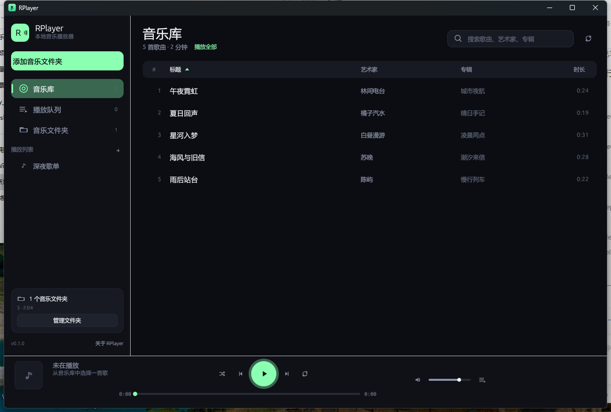

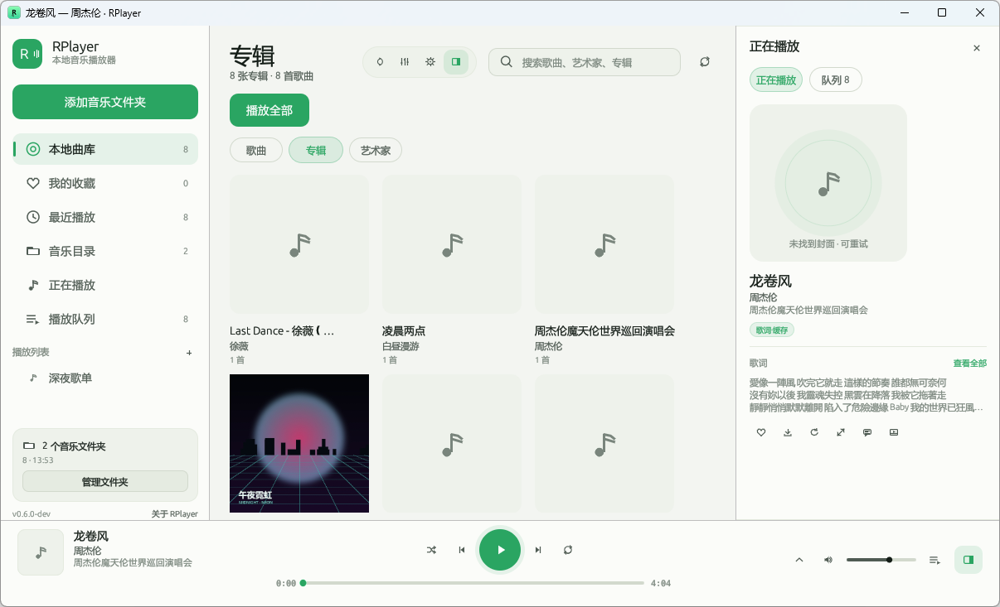

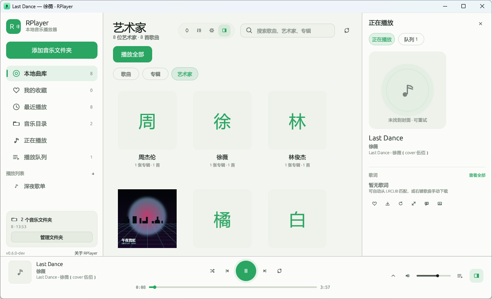

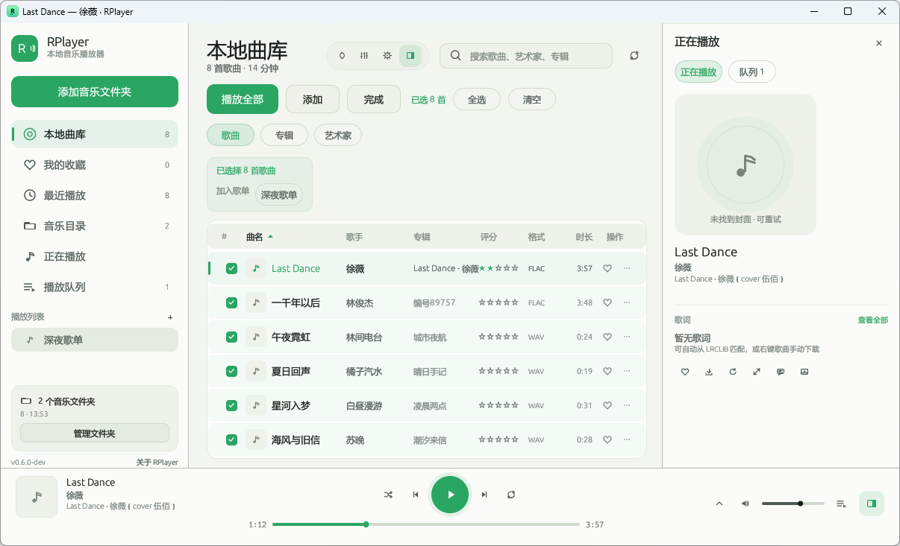

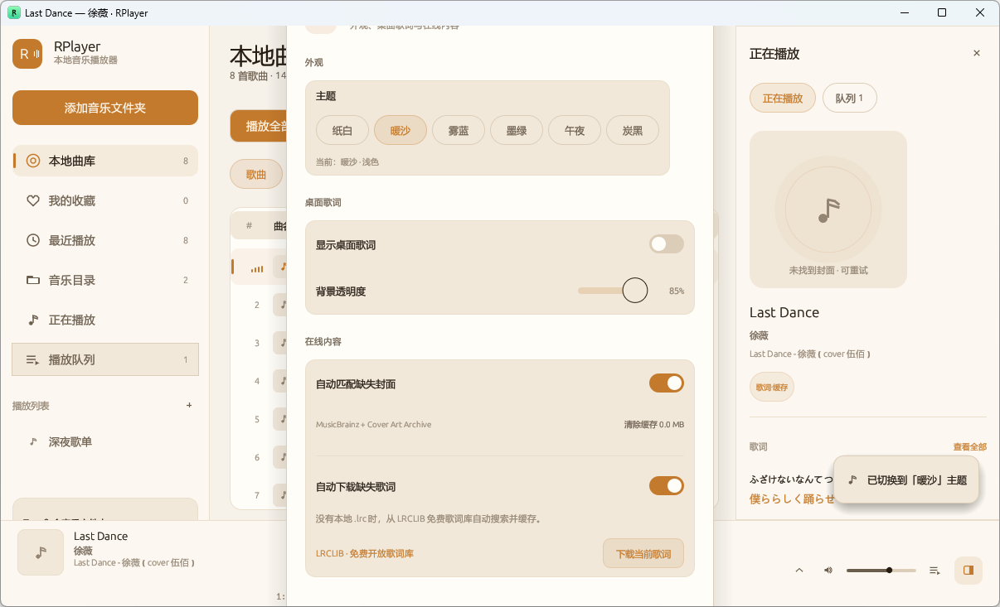

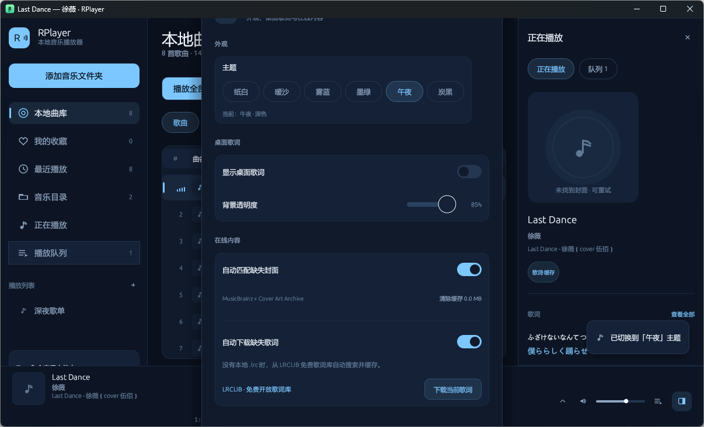

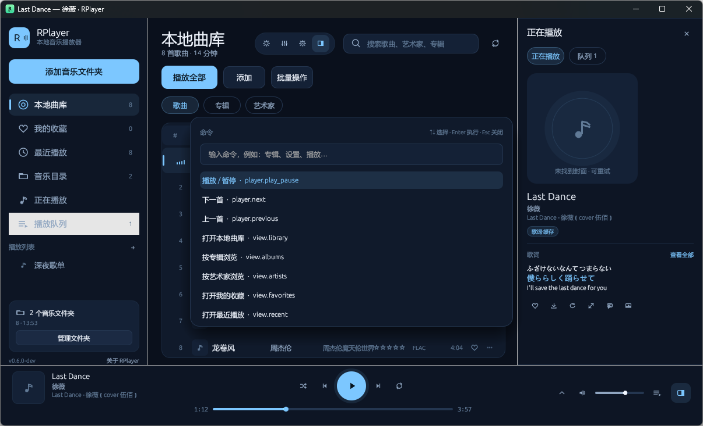

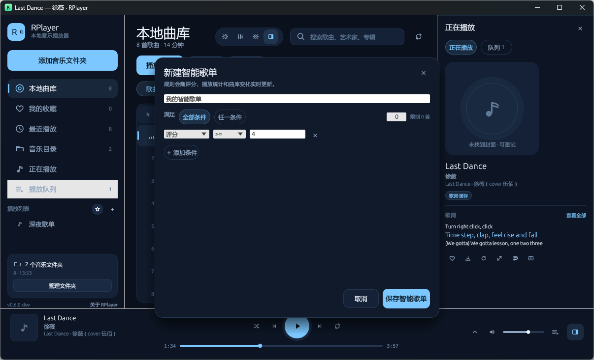

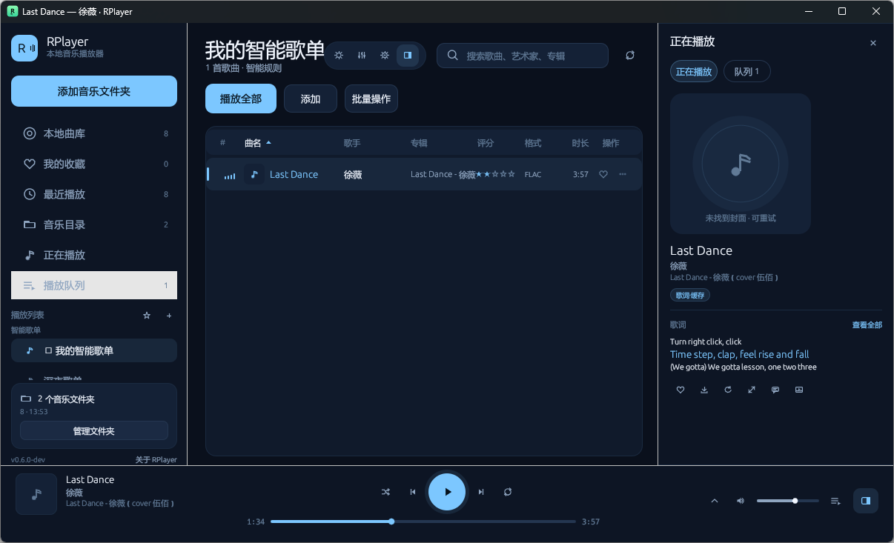

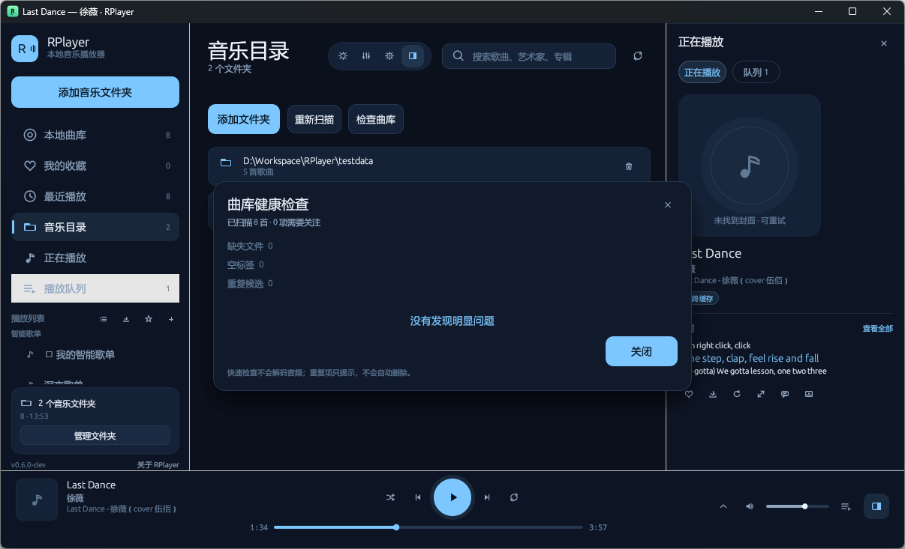


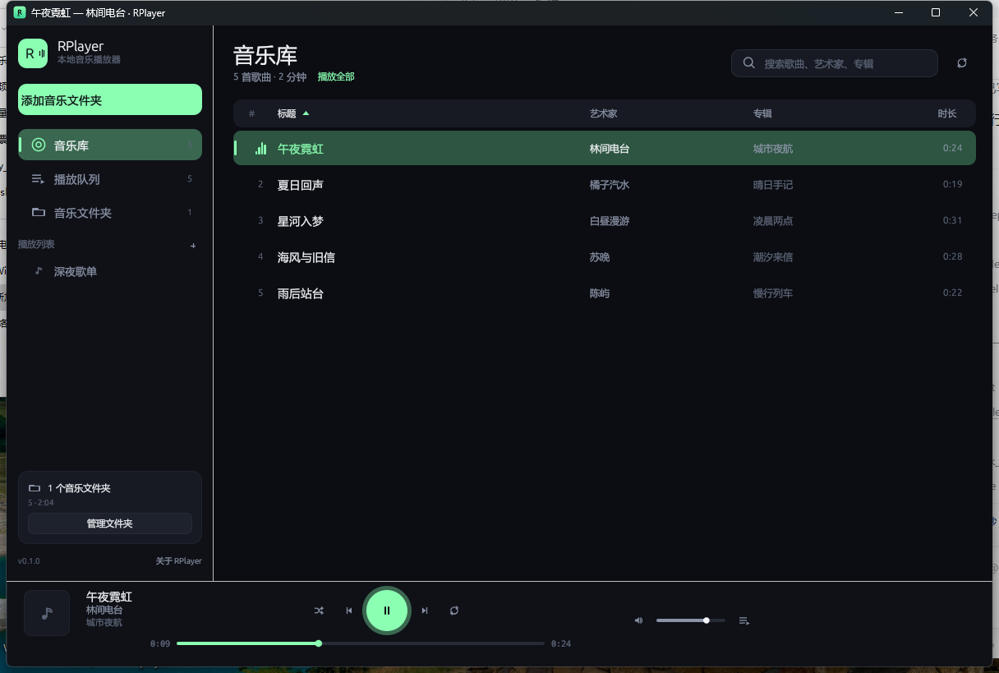


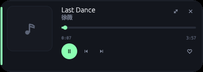

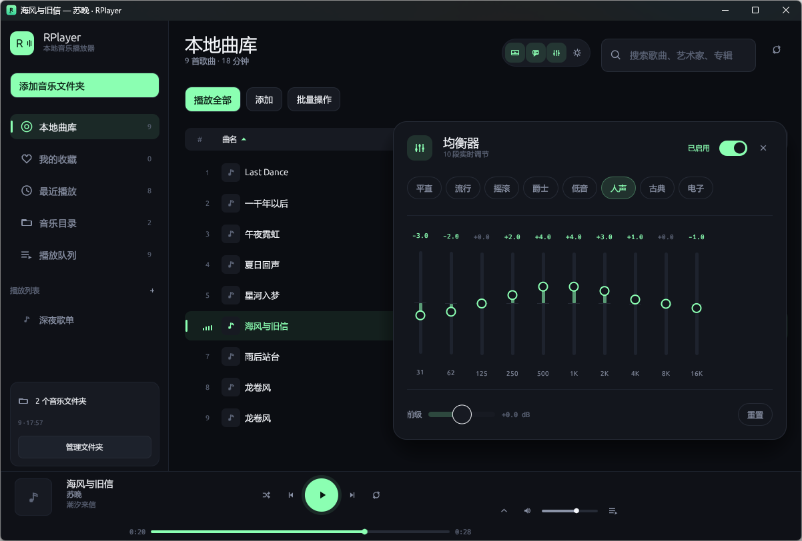

## 特性

- **本地音乐扫描**：递归扫描文件夹，支持常见音频格式，自动读取标题、艺术家、专辑、流派、年份、音轨号与时长。
- **封面匹配**：内嵌封面 > 同目录 `<歌曲名>.jpg` > `cover/folder/front.jpg` > 应用缓存 > MusicBrainz + Cover Art Archive 在线匹配；播放页与底栏同步展示，并标注来源。
- **音乐库管理**：按标题、艺术家、专辑或时长排序；支持关键词搜索；表格展示格式与快捷操作。
- **我的收藏 / 最近播放**：点歌曲右侧的心形即可收藏，最近播放自动记录最近 100 首，均可作为独立视图浏览。
- **批量操作**：进入批量模式后勾选歌曲，可批量加入歌单，或从当前歌单/收藏中移除。
- **浅色默认 / 深色可选**：首次启动为浅色纸张主题，图标或 `Ctrl + T` 秒切，标题栏、弹窗、播放栏与自绘控件同步换色；主题会记住。
- **LPlayer 风格曲库**：白色圆角曲库卡片、顶部工具组、绿色主按钮与轻量表格行，浅色下更接近 LPlayer 的信息层次。
- **常驻正在播放侧栏**：窗口宽度 ≥1200px 时，曲库右侧显示封面、来源、歌词预览和“接下来”；可随时收起。
- **全屏歌词页**：按 `F`、点侧栏「正在播放」或底栏封面/标题进入；大封面、当前行居中高亮、相邻行弱化，点击任意歌词行可跳转。
- **播放会话恢复**：重启后恢复上次歌曲、进度、队列、当前视图与音量；文件失效时自动跳过。
- **无缝播放**：在曲目结束前把下一首解码源追加到同一音频链，专辑曲目之间不再停掉 Sink；随机/循环/单曲循环同样适用。
- **全局媒体键**：Windows 下后台也可用键盘/耳机的播放暂停、上一首、下一首、停止键；不依赖窗口焦点。
- **Windows SMTC 媒体卡**：独立 `rplayer-smtc.exe` 辅助进程把标题、艺术家、播放状态和进度同步到任务栏/锁屏媒体卡，并接收系统播放控制。
- **本地歌词 + 在线歌词**：优先读取同名 `.lrc` 或内嵌歌词；没有本地歌词时，自动从 [LRCLIB](https://lrclib.net) 免费歌词库搜索并缓存，也支持右键或播放页手动重新下载。
- **桌面歌词**：独立置顶歌词条，显示上一行 / 当前行 / 下一行，可拖动、可关闭；设置中可调 35%–100% 的歌词条透明度，右键也能快速调。
- **迷你播放器**：与主窗口互斥切换的独立小窗；支持经典/紧凑样式、整窗拖动、贴边吸附、置顶开关、桌面歌词控制、播放/暂停、上下曲、进度、收藏与切回主窗口。
- **10 段均衡器**：31 Hz–16 kHz 实时调节，带前级、平直/流行/摇滚/爵士/低音/人声/古典/电子预设；关闭时完全旁路。
- **播放列表**：创建、重命名、删除播放列表；右键歌曲即可加入；播放列表只保存歌曲引用，不复制文件。
- **播放队列**：右侧栏查看队列、跳播、清空、拖动排序；队列与当前索引会持久化，支持随机播放与单曲/列表循环。
- **文件夹监听**：后台指纹监听已添加目录，新增/删除/修改音频后自动刷新曲库，无需手动重扫。
- **拖放导入**：把文件夹或音频文件直接拖进窗口即可导入。
- **桌面体验**：原生无边框悬浮窗、始终置顶、圆角窗口区域；Windows 下根据主题切换深色/浅色标题栏。
- **数据本地化**：音乐库、收藏、歌单、主题、均衡器与桌面歌词状态保存在本地 JSON 文件，不上传任何数据。

## 支持的格式

`mp3` · `flac` · `wav` · `ogg` · `oga` · `m4a` · `aac`

具体解码能力由 [Symphonia](https://github.com/pdeljanov/Symphonia) 提供，实际可播放格式取决于编译时启用的解码器。

## 快速开始

### Windows

需要先安装 Rust 与 C/C++ 链接器。推荐使用 [rustup](https://rustup.rs/) + **Visual Studio Build Tools**（MSVC 工具链）：

```powershell
rustup default stable-msvc
cargo run --release
```

如果使用 MinGW-w64（GNU 工具链），请确保 `gcc` 在 `PATH` 中：

```powershell
rustup default stable-gnu
cargo run --release
```

### macOS

```bash
xcode-select --install
curl --proto '=https' --tlsv1.2 -sSf https://sh.rustup.rs | sh
cargo run --release
```

### Linux（可选）

需要 ALSA、X11/Wayland 与字体相关开发包，例如 Debian/Ubuntu：

```bash
sudo apt install build-essential pkg-config libasound2-dev libxkbcommon-dev \
  libwayland-dev libx11-dev libxi-dev libxcursor-dev libxrandr-dev libgl1-mesa-dev
cargo run --release
```

### 构建与测试

```bash
cargo build --release   # 生成 target/release/rplayer
cargo test              # 模型、存储与扫描的单元测试
```

## 使用说明

1. 点击左上角 **添加音乐文件夹**，选择一个包含音乐的目录。
2. RPlayer 会在后台扫描，扫描完成后歌曲出现在 **音乐库**。
3. 双击歌曲播放，或选中后按空格；底部播放栏支持上一首/下一首、进度拖动与音量调节。
4. 点歌曲右侧的心形收藏；侧栏进入 **我的收藏** / **最近播放** 查看对应列表。
5. 右键歌曲可以加入播放列表、在文件夹中显示或从音乐库移除。
6. 点侧栏 **播放队列** 或底部右侧队列按钮查看当前队列。
7. 按 `F` 或点侧栏「正在播放」进入歌词页；点击任意有时间戳的歌词行可跳转。把歌词保存为与音频同名的 `.lrc`（例如 `song.wav` 对应 `song.lrc`），RPlayer 会自动加载并逐行高亮。
8. 窗口够宽时，曲库右侧会显示「正在播放」侧栏；点封面或「查看全部」进入完整播放页，点「队列」标签查看/拖动队列。
9. 没有本地封面时，RPlayer 会优先找同目录图片，再按设置自动向 MusicBrainz / Cover Art Archive 匹配；结果缓存到应用数据目录。右键歌曲可重新匹配。
10. 右上角工具组或快捷键可以切换主题、打开均衡器、桌面歌词、迷你播放器与设置；两个悬浮窗都可以直接拖动。
11. 均衡器默认关闭；打开开关后拖动任意频段，或点一个预设即可实时生效。
12. 没有本地 `.lrc` 时，RPlayer 会自动向 LRCLIB 查询歌词；下载结果缓存到应用数据目录，下次播放直接读取。也可以右键歌曲选择「从 LRCLIB 下载歌词」。
13. 设置窗口可以调整桌面歌词透明度、自动封面/歌词下载、清除封面缓存，以及切换浅色/深色主题。

### 快捷键

| 快捷键 | 功能 |
| --- | --- |
| `Space` | 播放 / 暂停 |
| `Ctrl + O` | 添加音乐文件夹 |
| `Ctrl + N` | 新建播放列表 |
| `F` | 打开 / 收起正在播放页 |
| `Ctrl + T` | 切换浅色 / 深色主题 |
| `Ctrl + E` | 打开 / 关闭均衡器 |
| `Ctrl + L` | 打开 / 关闭桌面歌词 |
| `Ctrl + M` | 打开 / 关闭迷你播放器 |
| `Ctrl + ,` | 打开 / 关闭设置 |
| `Ctrl + F` | 聚焦搜索框 |
| `Ctrl + ← / →` | 上一首 / 下一首 |
| `← / →` | 后退 / 前进 5 秒 |
| `↑ / ↓` | 音量 ±5% |
| `Delete` | 从音乐库移除选中歌曲（需确认） |
| `Esc` | 关闭对话框 / 均衡器 / 播放队列 / 正在播放页 |

> macOS 上把 `Ctrl` 换成 `Command` 即可。

## 数据存放位置

| 平台 | 路径 |
| --- | --- |
| Windows | `%APPDATA%\RPlayer\library.json` |
| macOS | `~/Library/Application Support/RPlayer/library.json` |
| Linux | `~/.local/share/RPlayer/library.json` |

`library.json` 包含音乐文件夹、歌曲元数据、收藏、最近播放、播放列表、音量、主题、均衡器、桌面歌词与在线内容设置。同一目录下还有：

- `session.json`：上次歌曲、进度、队列与当前视图；删除后从空白会话启动。
- `lyrics/`：LRCLIB 歌词缓存。
- `covers/`：在线封面缓存与未命中标记；设置中可一键清除。

删除 `library.json` 可恢复空白音乐库，删除 `lyrics/` 可清空在线歌词缓存。

## 技术栈

| 领域 | 选择 |
| --- | --- |
| GUI | [egui](https://github.com/emilk/egui) / eframe 0.31 |
| 音频播放 | [rodio](https://github.com/RustAudio/rodio) 0.19 + Symphonia |
| 均衡器 | 自研 10 段 peaking biquad 级联，实时参数更新 |
| 在线歌词 | [LRCLIB](https://lrclib.net) 免费开放 API + 系统 `curl` 请求 |
| 在线封面 | [MusicBrainz](https://musicbrainz.org/) + [Cover Art Archive](https://coverartarchive.org/)；遵守 1 请求/秒与 User-Agent 约定 |
| 标签读取 | [lofty](https://github.com/Serial-ATA/lofty-rs) 0.21 |
| 封面处理 | image 0.25 |
| 文件夹选择 | rfd 0.15 |
| 目录遍历 | walkdir 2.5 |
| 序列化 | serde / serde_json |

界面全部由 egui 即时绘制，图标与进度条为自绘，不依赖 WebView 或前端资源。

## 项目结构

```text
RPlayer/
├─ assets/              应用图标
├─ docs/                README 截图
├─ src/
│  ├─ main.rs           入口与窗口配置
│  ├─ app/
│  │  ├─ mod.rs         应用状态、播放调度、快捷键
│  │  ├─ sidebar.rs     侧栏与播放列表
│  │  ├─ library_view.rs 音乐库/收藏/最近/目录视图
│  │  ├─ player_bar.rs  底部播放栏与队列
│  │  ├─ now_playing.rs 全屏歌词页、封面与队列
│  │  ├─ now_rail.rs    常驻正在播放侧栏
│  │  ├─ equalizer.rs   10 段均衡器悬浮面板
│  │  ├─ settings.rs    主题、歌词、封面与在线内容设置
│  │  ├─ session.rs     播放会话恢复
│  │  └─ dialogs.rs     新建/重命名/删除/文件夹/关于
│  ├─ audio.rs          rodio 播放引擎与定位补偿
│  ├─ eq.rs             10 段 EQ DSP、预设与实时音频源
│  ├─ cover.rs          本地封面优先级、缓存 key 与读写
│  ├─ cover_fetch.rs    MusicBrainz 搜索 + Cover Art Archive 下载
│  ├─ lyrics.rs         LRC/内嵌歌词解析、逐行定位与缓存
│  ├─ lyrics_fetch.rs   LRCLIB 搜索、匹配与后台下载
│  ├─ model.rs          Track / Playlist / Library 与标签读取
│  ├─ overlay.rs        桌面歌词与迷你播放器视口
│  ├─ scanner.rs        后台扫描线程
│  ├─ session.rs        会话 JSON
│  ├─ watch.rs          文件夹指纹监听
│  ├─ storage.rs        library/session/歌词/封面路径
│  ├─ theme.rs          双主题调色板、字体、控件样式
│  ├─ platform.rs       Windows 标题栏与悬浮窗圆角区域
│  └─ ui/               自绘图标与通用控件
├─ tools/               测试音乐生成脚本
└─ Cargo.toml
```

## 开发说明

- 扫描在独立线程中进行，通过 `mpsc` 事件把结果送回 UI，扫描时仍可继续操作。
- 播放位置来自 `rodio::Sink::get_pos()`，拖动进度条时调用 `try_seek`，并把已补偿的位置写回。
- 音乐库以原子方式保存：先写 `library.json.tmp`，再替换正式文件，避免异常退出损坏数据。
- 歌曲 ID 由规范化路径的 FNV-1a 哈希生成；Windows 下路径比较不区分大小写。
- 歌词先找同名 `.lrc`，再读标签内嵌歌词；支持带时间戳的逐行高亮，无时间戳时按纯文本展示。
- 均衡器在解码器与 `rodio::Sink` 之间串入 `EqualizerSource`：每声道 10 个 peaking biquad，串联处理；设置通过共享句柄热更新，无需重开歌曲。
- 桌面歌词与迷你播放器使用独立的置顶 viewport；Windows 下用 `SetWindowRgn` 做圆角窗口区域，并用 `SetLayeredWindowAttributes` 控制歌词条整体透明度。
- 在线歌词通过系统 `curl` 请求 LRCLIB，工作线程完成搜索与匹配，主界面只接收结果；下载结果写入 `%APPDATA%\RPlayer\lyrics`，不修改音乐文件夹。
- 封面按“内嵌 → 歌曲同名图片 → 目录图片 → 缓存 → 在线”查找；在线请求由独立线程串行执行，MusicBrainz 限制为平均 1 请求/秒，封面按专辑缓存。
- 播放会话与音乐库分开写入 `session.json`，每 5 秒及退出时原子保存；启动时以暂停状态恢复，避免突然出声。
- 文件夹监听使用后台线程对音频路径、大小与修改时间做指纹，变化时触发后台刷新流程。
- 不抓取商业音乐平台封面，也不使用条款限制为“商店推广”的封面 API；未匹配时保留占位图并允许重试。
- LRCLIB 与 MusicBrainz 都是免费开放服务，查询会发送曲名、艺术家与专辑信息；不包含账号或遥测。
- 当前版本只播放本地文件，不包含在线音乐、音效市场或账号系统。

## 需求与路线图

完整的产品定位、竞品调研、P0/P1/P2 需求、现状差距与版本路线图见 [docs/REQUIREMENTS.md](docs/REQUIREMENTS.md)。

v0.5 的页面设计、在线封面方案、验收标准与后续增量见 [docs/V0.5_PLAN.md](docs/V0.5_PLAN.md)；设计参考与实机效果见 [docs/V0.5_DESIGN.md](docs/V0.5_DESIGN.md)。

v0.6 的曲库深度规划、专辑/艺术家视图、评分与统计、智能歌单、标签编辑、M3U、ReplayGain 与版本拆分见 [docs/V0.6_PLAN.md](docs/V0.6_PLAN.md)。

## 版本记录

### v0.10.3

- 关于界面内容水平居中、整体垂直居中。
- 桌面歌词文字移除阴影。
- 提高浅色主题 muted / faint 文字对比度，改善表头、副标题清晰度。
- 迷你播放器移除边框描边，避免与界面颜色冲突。

### v0.10.2

- DirectComposition 面板改用无背景自绘窗口类，去掉圆角外的灰色直角。
- 关闭 DWM 非客户区渲染、边框颜色和圆角偏好，减少残余阴影。
- 歌词文字阴影改为白色柔光，去除黑色描边。
- 生产构建 `cargo test --release`：27 passed。

### v0.10.1

- 修复关闭桌面歌词后 DirectComposition 面板残留空白窗口。
- 歌词面板齿轮/关闭图标改为白色，提高对比度。
- 修复曲库列表表头与卡片上边界之间的空隙。
- 模块切换增加轻微下滑 + 淡入过渡，时长放宽到约 0.25 秒。

### v0.10.0

- 桌面歌词面板改用 DirectComposition + D3D11 合成表面，支持预乘 alpha 与 18px 圆角。
- 面板接入 DWM 背景模糊，提供磨砂玻璃观感；初始化失败自动回退分层窗口。
- 页面切换增加 ease-out 淡入过渡，按钮按下增加 97.5% 缩放反馈。
- 新增 `AGENTS.md` 作为 AI 友好工程规范。
- 生产构建 `cargo test --release`：27 passed。

### v0.9.0

- 默认离线模式：自动联网歌词/封面默认关闭，手动操作仍可用。
- 曲库迁移 SQLite：曲目独立存储，JSON 仅保留设置与歌单。
- 增量扫描：未修改文件跳过元数据解析。
- 播放错误恢复：缺失/损坏文件自动跳过，继续队列。
- 本地歌词支持 GBK 编码。
- 设置文件支持 `.tmp` / `.bak` 恢复，降低异常退出丢歌单风险。
- 生产构建 `cargo test --release`：27 passed。

### v0.8.1

- 「添加音乐文件夹」「播放全部」「添加」「批量操作」按钮增加对应的矢量图标。
- 批量模式进入后按钮显示「完成」并使用勾选图标。
- 专辑/艺术家页的「播放全部」同步增加播放图标。
- 生产构建 `cargo test --release`：25 passed。

### v0.8.0

- 主界面全部主题的组件边框颜色调浅，降低视觉噪声。
- 桌面歌词面板增加 18px 圆角。
- 歌词面板与歌词文字拆分为独立绘制层：面板透明度不再改变歌词文字透明度。
- 面板 0% 时完全隐藏，悬停时显示 16% 面板提示；关闭歌词会同步隐藏面板窗口。
- 已知限制：受 Windows 透明合成能力限制，面板使用分层纯色渲染，不是磨砂玻璃效果。
- 生产构建 `cargo test --release`：25 passed。

### v0.7.1

- 修复桌面歌词面板 0% 时显示黑色：存储层不再把透明度夹到 0.35，0% 使用颜色键透明。
- 「透明」按钮改为齿轮图标，透明度随面板变化，悬停/面板 0% 时仍可找到。
- 歌词窗口保持非激活，焦点切换不再出现标题栏/边框闪烁。
- 面板 0% 且鼠标悬停时临时以 16% 窗口 alpha 显示面板，文字多遍绘制保持可读；移出后恢复完全透明。
- 齿轮与关闭按钮透明度严格跟随面板；面板 0% 时隐藏。
- 点击外部、Esc 或窗口失焦会收起透明度面板。
- 生产构建 `cargo test --release`：25 passed。

### v0.7.0

- 桌面歌词面板透明度与歌词文字透明度拆分：面板 0% 时背景完全透明，文字仍可见。
- 桌面歌词左上角新增「透明」按钮，可直接调两个不透明度；右键菜单与设置同步提供。
- 循环与随机按钮合并为单按钮，循环切换：顺序播放 → 列表循环 → 单曲循环 → 随机播放 → 随机循环。
- 随机模式使用洗牌袋，一轮内不重复；随机循环在一轮结束后重新洗牌继续。
- 新增随机循环图标。
- `cargo test --release`：25 passed。

### v0.6.0

- 底部播放栏改为左/中/右三段：播放控制居中，音量/队列/侧栏工具组贴右，进度条占满中段。
- 主按钮、次按钮、胶囊标签统一内边距、最小宽度、高度与操作行间距；侧栏“添加音乐文件夹”文字居中。
- `build.rs` 将 `assets/icon.ico` 与版本信息嵌入 `RPlayer.exe` 和 `rplayer-smtc.exe`；资源管理器/任务栏/窗口图标统一为 RPlayer。
- 新增独立 `playback_stats.json`：0–5 星评分、播放次数、跳过次数、首次/最近播放与最近跳过；不写入音频标签。
- 曲库新增“评分”列，正在播放页可直接点星评分并显示播放/跳过次数；切歌、无缝边界和退出时自动计入统计。
- 曲库新增「歌曲 / 专辑 / 艺术家」浏览切换；专辑封面网格、专辑详情、艺术家详情；单曲/整张/整位艺术家播放与加入队列。
- 专辑封面缩略图在后台线程加载，避免滚动时解码阻塞 UI。
- 曲库支持 Shift 范围选择、Ctrl 点选、Ctrl+A 全选、批量加入歌单/队列、拖动到歌单或播放队列。
- 新增 6 套主题预设：纸白、暖沙、雾蓝、墨绿、午夜、炭黑；设置中可切换，`Ctrl+T` 在主题家族内切换浅/深。
- 新增 `Ctrl+K` 命令面板：搜索并执行播放、浏览、设置、主题、扫描等动作，显示稳定动作 ID。
- 新增智能歌单：按标题/艺术家/专辑/流派/年份/评分/播放次数/跳过次数组合规则，全部/任一匹配，可限制数量并实时更新。
- 新增 M3U/M3U8 导入导出：相对路径解析、缺失歌曲跳过、当前视图导出。
- 新增曲库健康检查：缺失文件、空标签、重复候选；可移除失效记录，重复项只提示不自动删除。
- 启用 AccessKit：Windows UI Automation 可读取播放/切歌/侧栏/搜索/进度条等控件名称与状态。
- 新增 ReplayGain：读取 Track/Album 增益标签，在 EQ 前应用，设置中可选关闭/单曲/专辑，峰值保守限制 ±12dB。
- 新增单曲/批量标签编辑：标题/艺术家/专辑/流派/年份；写入前记录 `tag_backups.jsonl`，写后重新读取并刷新曲库。
- 批量操作条新增「编辑标签…」，只写入已填写字段。
- 新增歌词时间轴偏移：按曲目保存 ±5 秒，页面/侧栏/桌面歌词同步。
- 桌面歌词新增 18–40px 字号与位置锁定；右键菜单可直接调字号/锁定，设置中同样可调；位置写入 library.json，重启恢复。
- 桌面歌词入口统一改为「词」字按钮；底部新增迷你播放器按钮；迷你窗口可拖动、贴边吸附、切换始终置顶、控制桌面歌词，并可在经典/紧凑样式间切换。
- 新增 Windows 系统托盘：关闭窗口隐藏到托盘、播放继续；托盘菜单含显示/播放控制/桌面歌词/设置/退出。
- SMTC 媒体卡新增封面缩略图通路：主程序写入临时 PNG，helper 通过 `RandomAccessStreamReference` 设置 thumbnail；当前曲目无封面时使用透明占位；内嵌封面曲目已在媒体卡实机显示。应用名显示 RPlayer；首次运行自动创建带 AUMID 的开始菜单快捷方式。
- 批量操作新增「加入播放队列」；侧栏新增拖放队列目标；智能歌单支持右键编辑已有规则。
- v0.6.0 计划项全部完成；最终测试 24 passed。

### v0.5.0

- 新增常驻「正在播放」右侧栏：封面、来源徽标、歌词预览、队列入口，可随窗口宽度自动收起。
- 全屏歌词页重做：点击歌词跳转、当前行居中高亮、封面主色背景、封面/歌词来源标识。
- 新增 MusicBrainz + Cover Art Archive 在线封面匹配，支持同名图片、目录图片、专辑级缓存、失败负缓存与重试。
- 新增播放会话恢复：歌曲、进度、队列、视图、音量；启动后以暂停状态回到上次位置。
- 队列支持右侧栏拖动排序、清空与持久化。
- 文件夹监听：音频新增/删除/修改后自动刷新曲库。
- 播放定位增加解码器 seek 失败时的解码跳过回退。
- 无缝播放：下一首提前追加到同一 Sink，专辑曲目边界不再重建播放链；手动切歌/定位会安全回退。
- Windows 全局媒体键：后台播放/暂停、上一首、下一首、停止。
- Windows SMTC：通过独立辅助进程把标题、艺术家、播放状态/进度同步到任务栏/锁屏媒体卡，并接收系统按钮；辅助进程随主程序启动和退出。
- 设置新增自动封面、来源说明与封面缓存清理；版本号升级到 0.5.0。

### v0.4.0

- 浅色成为默认主题，旧版设置会做一次迁移；重新打磨曲库卡片与顶部工具组。
- 设置窗口：主题、桌面歌词开关、透明度、自动歌词下载与 LRCLIB 来源。
- 新增 LRCLIB 在线歌词自动/手动下载，带时长匹配、逐行歌词优先、本地缓存与后台线程。
- 桌面歌词条支持 35%–100% 透明度，右键可快速调整。
- 歌词面板支持纯文本歌词与无时间戳歌词的展示。

### v0.3.0

- 新增浅色 / 深色双主题，标题栏、弹窗、自绘控件与悬浮窗同步换色。
- 新增置顶桌面歌词条，展示上一行 / 当前行 / 下一行，可拖动。
- 新增置顶迷你播放器，含封面、进度、播放控制、收藏与展开主窗口。
- 新增 10 段实时均衡器与 8 组预设，设置会持久化。
- 重新打磨顶部工具组、图标、滚动条、浅色配色与正在播放页背景。
- 标题栏与悬浮窗支持 Windows 圆角/主题适配。

### v0.2.0

- 新增「我的收藏」「最近播放」「音乐目录」三个独立视图。
- 音乐库表格增加格式、收藏与操作列，支持批量选择。
- 新增全屏正在播放页：环境光背景、大封面、歌词逐行高亮、右侧播放队列。
- 新增 `.lrc` / 内嵌歌词读取；`F` 快捷键打开正在播放页。
- 修复半透明表面因预乘 alpha 导致的过亮问题，整体层次更细腻。

### v0.1.0

- 本地扫描、标签读取、音乐库、播放列表、播放队列与基础播放控制。

## License

MIT
