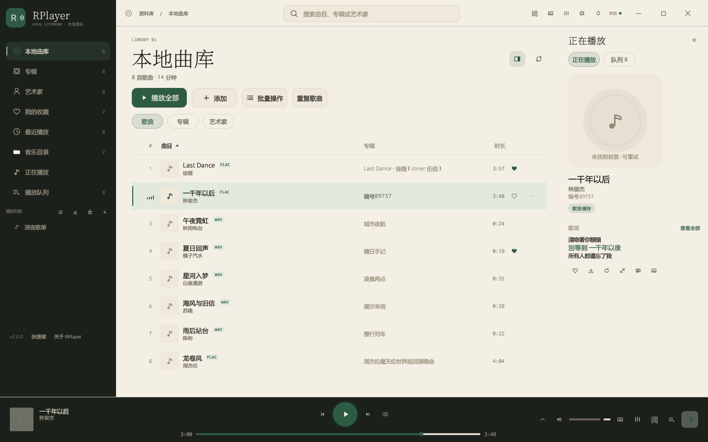
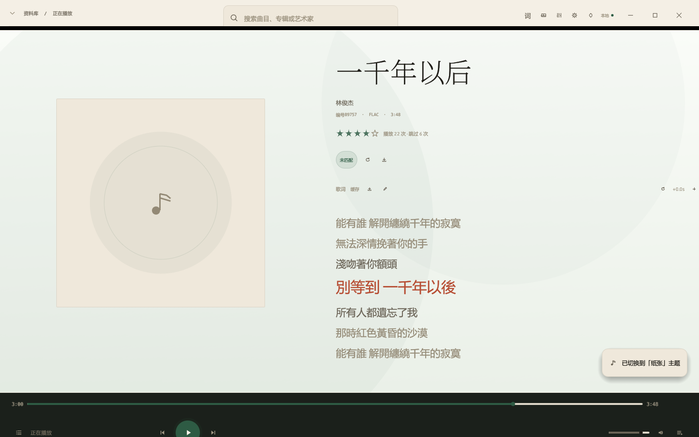
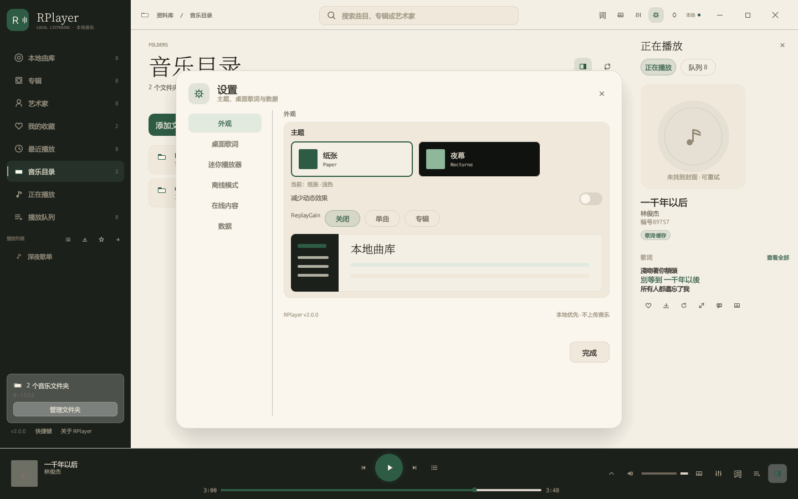
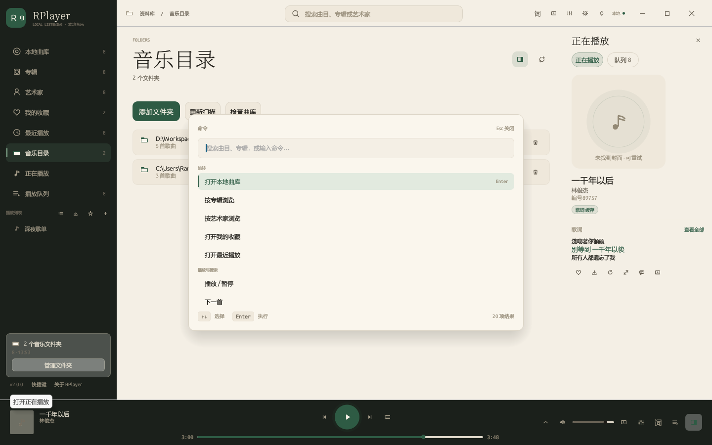
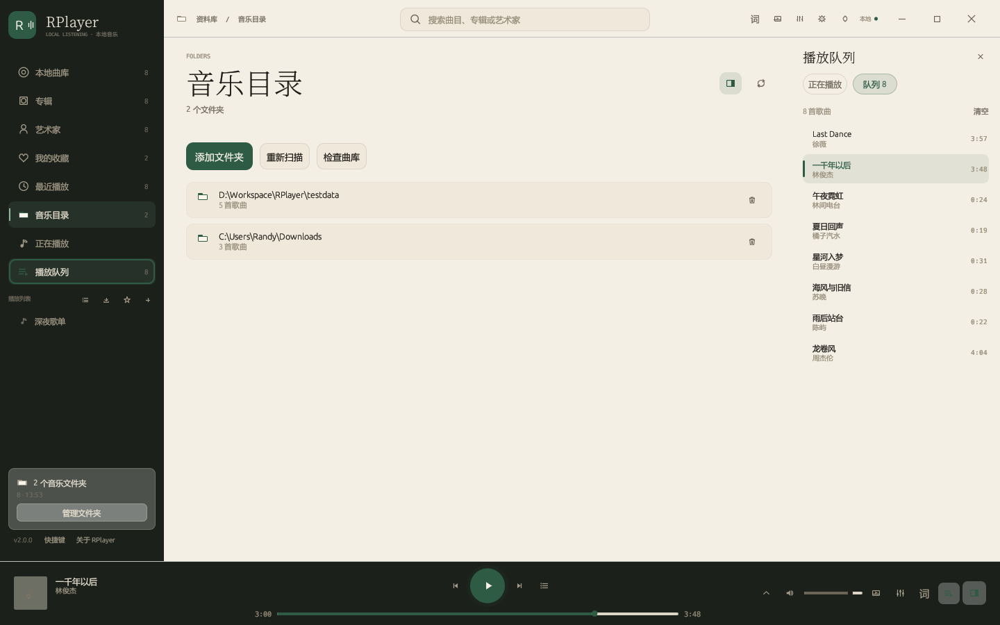

# RPlayer

RPlayer 是一个用 **Rust** 编写的本地桌面音乐播放器。它不依赖账号、云服务或网页技术栈，启动即用：选择音乐文件夹，扫描标签与封面，然后在清爽的浅色或深色界面里听歌。

v2.0 “Listening Room” 是一次完整的界面重构：暖纸色内容区、深森林绿侧栏、衬线标题、四列曲库、全高队列抽屉与可缩放的正在播放页。它保留 v0.13.5 的全部曲库、歌词、标签、CUE、备份与播放能力，只重做视觉、布局、交互与动效。两套主题“纸张 / 夜幕”、无边框标题栏、236px 侧栏、54px 顶栏、92px 播放条与 300px 右栏构成新的桌面骨架。



v0.5 参考 Spotify 桌面端“左侧曲库 + 右侧 Now Playing”和 Apple Music 的全屏歌词，把播放页做成真正的第二界面：曲库右侧常驻封面、歌词与队列，按 `F` 进入沉浸式歌词页。同时加入 MusicBrainz / Cover Art Archive 在线封面、播放会话恢复、队列拖动排序、文件夹监听，以及本地/在线封面优先级与缓存。

v0.6 已完成：底栏三段布局、Windows exe/helper 图标、评分与播放统计、专辑/艺术家浏览、多选与拖拽、智能歌单、六套主题、AccessKit/Ctrl+K、单曲与批量标签编辑、曲库健康检查、M3U、ReplayGain、歌词偏移与桌面歌词设置、系统托盘、SMTC 封面与应用名。

v0.7 已完成：桌面歌词面板透明度与歌词文字透明度独立调节；循环与随机合并为单按钮五态播放模式（顺序/列表循环/单曲循环/随机/随机循环）。

v0.8–v0.13 已完成：DirectComposition 桌面歌词、歌词逐句编辑与时间轴编辑、歌词重新匹配与候选选择、CUE 虚拟曲目与分段播放、重复歌曲清理、曲库健康检查、批量标签撤销、数据备份与恢复、页面与控件动效、键盘焦点与快捷键帮助、项目路线图。

v2.0.x 已完成：Listening Room 视觉系统、纸张 / 夜幕双主题、无边框标题栏与原生边缘缩放、四列曲库、五列专辑与艺术家墙、全高队列抽屉、六页签设置、分组命令面板、深色均衡器与迷你播放器、衬线桌面歌词；v2.0.1 补齐统一右键菜单、对话框焦点与命令面板键盘滚动；`cargo test --release` 70 passed。










## 特性

- **本地音乐扫描**：递归扫描文件夹，支持常见音频格式，自动读取标题、艺术家、专辑、流派、年份、音轨号与时长。
- **封面匹配**：内嵌封面 > 同目录 `<歌曲名>.jpg` > `cover/folder/front.jpg` > 应用缓存 > MusicBrainz + Cover Art Archive 在线匹配；播放页与底栏同步展示，并标注来源。
- **音乐库管理**：按标题、艺术家、专辑或时长排序；支持关键词搜索；表格展示格式与快捷操作。
- **我的收藏 / 最近播放**：点歌曲右侧的心形即可收藏，最近播放自动记录最近 100 首，均可作为独立视图浏览。
- **批量操作**：进入批量模式后勾选歌曲，可批量加入歌单，或从当前歌单/收藏中移除；批量标签保存后可用命令面板的「撤销上次批量标签」恢复。
- **键盘与焦点**：侧栏、歌曲行、播放栏和弹窗按钮都显示 2px 主题色焦点环；Tab/Shift+Tab 移动焦点，Space/Enter 激活；歌曲行内用 `↑/↓` 逐行、`Home/End` 首尾、`PageUp/PageDown` 翻页，焦点行自动滚入视口；进度条与音量条获得焦点后可用方向键微调，`F1` 打开完整快捷键表。
- **纸张 / 夜幕双主题**：纸张为暖纸色内容区 + 深色侧栏，夜幕为深绿黑界面；`Ctrl + T` 秒切，标题栏、弹窗、播放栏与自绘控件同步换色，偏好会记住。
- **聆听室曲库**：236px 深色侧栏、54px 自绘顶栏、42px 衬线页头与四列 56px 曲库；当前行用 2px 左侧色条与柔和绿底强调，格式以单色小标签贴在标题后。
- **无边框窗口**：自绘最小化 / 最大化 / 关闭按钮；拖拽面包屑移动窗口，左右与底边可原生缩放，顶部保留拖动热区。
- **常驻正在播放侧栏**：窗口宽度 ≥1280px 时，曲库右侧显示 300px 封面、来源、歌词预览和“接下来”；可随时收起。
- **全屏歌词页**：按 `F`、点侧栏「正在播放」或底栏封面/标题进入；大封面、当前行居中高亮、相邻行弱化，点击任意歌词行可跳转。
- **播放会话恢复**：重启后恢复上次歌曲、进度、队列、当前视图与音量；文件失效时自动跳过。
- **无缝播放**：在曲目结束前把下一首解码源追加到同一音频链，专辑曲目之间不再停掉 Sink；随机/循环/单曲循环同样适用。
- **全局媒体键**：Windows 下后台也可用键盘/耳机的播放暂停、上一首、下一首、停止键；不依赖窗口焦点。
- **Windows SMTC 媒体卡**：独立 `rplayer-smtc.exe` 辅助进程把标题、艺术家、播放状态和进度同步到任务栏/锁屏媒体卡，并接收系统播放控制。
- **本地歌词 + 在线歌词**：优先读取用户编辑过的歌词、同名 `.lrc` 或内嵌歌词；没有本地歌词时，自动从 [LRCLIB](https://lrclib.net) 免费歌词库搜索并缓存，也支持右键或播放页手动重新下载、重新匹配与选择候选版本。
- **歌词编辑**：可逐句修改歌词文字与时间轴，支持新增、删除、校准时间并保存为本地自定义歌词；用户编辑优先于目录里的 `.lrc` 和下载缓存。
- **CUE 专辑**：识别 `.cue` 并将单文件音频拆成虚拟曲目，按每首的起点/终点播放、显示单曲时长并在终点自动切歌；移动整轨后可整组重定位。支持 `INDEX 01`、空格/中文文件名；含多个 `FILE` 的 CUE 暂不支持。
- **曲库维护**：重复歌曲检查按同名/同艺术家/时长接近分组，可逐首“定位”或“仅保留此首”，移除只删曲库记录、不动磁盘文件；健康检查列出缺失文件、空标签与重复候选，支持单曲重定位和批量替换根目录。
- **数据备份与恢复**：设置页可把设置、SQLite 曲库、播放统计和会话打包到独立文件夹，封面/歌词缓存可选；恢复前自动备份当前数据并校验 JSON/SQLite，损坏备份不会覆盖现有数据，也支持只恢复设置与播放列表。
- **桌面歌词**：独立置顶歌词条，显示上一行 / 当前行 / 下一行，可拖动、可关闭；设置中可调 35%–100% 的歌词条透明度，右键也能快速调。
- **迷你播放器**：与主窗口互斥切换的独立小窗；支持经典/紧凑样式、整窗拖动、贴边吸附、置顶开关、桌面歌词控制、播放/暂停、上下曲、进度、收藏与切回主窗口。
- **10 段均衡器**：31 Hz–16 kHz 实时调节，带前级、平直/流行/摇滚/爵士/低音/人声/古典/电子预设；关闭时完全旁路。
- **播放列表**：创建、重命名、删除播放列表；右键歌曲即可加入；播放列表只保存歌曲引用，不复制文件。
- **播放队列**：右侧栏查看队列、跳播、清空、拖动排序；队列与当前索引会持久化，支持随机播放与单曲/列表循环。
- **文件夹监听**：后台指纹监听已添加目录，新增/删除/修改音频后自动刷新曲库，无需手动重扫。
- **拖放导入**：把文件夹或音频文件直接拖进窗口即可导入。
- **桌面体验**：原生无边框悬浮窗、始终置顶、圆角窗口区域；Windows 下根据主题切换深色/浅色标题栏。
- **数据本地化**：音乐库、收藏、歌单、主题、均衡器与桌面歌词状态保存在本地 JSON 文件，不上传任何数据。

## 支持的格式

`mp3` · `flac` · `wav` · `ogg` · `oga` · `m4a` · `aac`

具体解码能力由 [Symphonia](https://github.com/pdeljanov/Symphonia) 提供，实际可播放格式取决于编译时启用的解码器。

## 快速开始

### Windows

需要先安装 Rust 与 C/C++ 链接器。推荐使用 [rustup](https://rustup.rs/) + **Visual Studio Build Tools**（MSVC 工具链）：

```powershell
rustup default stable-msvc
cargo run --release
```

如果使用 MinGW-w64（GNU 工具链），请确保 `gcc` 在 `PATH` 中：

```powershell
rustup default stable-gnu
cargo run --release
```

### macOS

```bash
xcode-select --install
curl --proto '=https' --tlsv1.2 -sSf https://sh.rustup.rs | sh
cargo run --release
```

### Linux（可选）

需要 ALSA、X11/Wayland 与字体相关开发包，例如 Debian/Ubuntu：

```bash
sudo apt install build-essential pkg-config libasound2-dev libxkbcommon-dev \
  libwayland-dev libx11-dev libxi-dev libxcursor-dev libxrandr-dev libgl1-mesa-dev
cargo run --release
```

### 构建与测试

```bash
cargo build --release   # 生成 target/release/rplayer
cargo test              # 模型、存储与扫描的单元测试
```

## 使用说明

1. 点击左上角 **添加音乐文件夹**，选择一个包含音乐的目录。
2. RPlayer 会在后台扫描，扫描完成后歌曲出现在 **音乐库**。
3. 双击歌曲播放，或选中后按空格；底部播放栏支持上一首/下一首、进度拖动与音量调节。
4. 点歌曲右侧的心形收藏；侧栏进入 **我的收藏** / **最近播放** 查看对应列表。
5. 右键歌曲可以加入播放列表、在文件夹中显示或从音乐库移除。
6. 点侧栏 **播放队列** 或底部右侧队列按钮查看当前队列。
7. 按 `F` 或点侧栏「正在播放」进入歌词页；点击任意有时间戳的歌词行可跳转。把歌词保存为与音频同名的 `.lrc`（例如 `song.wav` 对应 `song.lrc`），RPlayer 会自动加载并逐行高亮。
8. 窗口够宽时，曲库右侧会显示「正在播放」侧栏；点封面或「查看全部」进入完整播放页，点「队列」标签查看/拖动队列。
9. 没有本地封面时，RPlayer 会优先找同目录图片，再按设置自动向 MusicBrainz / Cover Art Archive 匹配；结果缓存到应用数据目录。右键歌曲可重新匹配。
10. 右上角工具组或快捷键可以切换主题、打开均衡器、桌面歌词、迷你播放器与设置；两个悬浮窗都可以直接拖动。
11. 均衡器默认关闭；打开开关后拖动任意频段，或点一个预设即可实时生效。
12. 没有本地 `.lrc` 时，RPlayer 会自动向 LRCLIB 查询歌词；下载结果缓存到应用数据目录，下次播放直接读取。也可以右键歌曲选择「从 LRCLIB 下载歌词」。
13. 设置窗口可以调整桌面歌词透明度、自动封面/歌词下载、清除封面缓存，以及切换浅色/深色主题。

### 快捷键

| 快捷键 | 功能 |
| --- | --- |
| `Space` | 播放 / 暂停 |
| `Ctrl + O` | 添加音乐文件夹 |
| `Ctrl + N` | 新建播放列表 |
| `F` | 打开 / 收起正在播放页 |
| `Ctrl + T` | 切换浅色 / 深色主题 |
| `Ctrl + E` | 打开 / 关闭均衡器 |
| `Ctrl + L` | 打开 / 关闭桌面歌词 |
| `Ctrl + M` | 打开 / 关闭迷你播放器 |
| `Ctrl + ,` | 打开 / 关闭设置 |
| `Ctrl + F` | 聚焦搜索框 |
| `Ctrl + ← / →` | 上一首 / 下一首 |
| `← / →` | 后退 / 前进 5 秒 |
| `↑ / ↓` | 音量 ±5% |
| `Delete` | 从音乐库移除选中歌曲（需确认） |
| `Esc` | 关闭对话框 / 均衡器 / 播放队列 / 正在播放页 |

> macOS 上把 `Ctrl` 换成 `Command` 即可。

## 数据存放位置

| 平台 | 路径 |
| --- | --- |
| Windows | `%APPDATA%\RPlayer\library.json` |
| macOS | `~/Library/Application Support/RPlayer/library.json` |
| Linux | `~/.local/share/RPlayer/library.json` |

`library.json` 包含音乐文件夹、歌曲元数据、收藏、最近播放、播放列表、音量、主题、均衡器、桌面歌词与在线内容设置。同一目录下还有：

- `session.json`：上次歌曲、进度、队列与当前视图；删除后从空白会话启动。
- `lyrics/`：LRCLIB 歌词缓存。
- `covers/`：在线封面缓存与未命中标记；设置中可一键清除。

删除 `library.json` 可恢复空白音乐库，删除 `lyrics/` 可清空在线歌词缓存。

## 技术栈

| 领域 | 选择 |
| --- | --- |
| GUI | [egui](https://github.com/emilk/egui) / eframe 0.31 |
| 音频播放 | [rodio](https://github.com/RustAudio/rodio) 0.19 + Symphonia |
| 均衡器 | 自研 10 段 peaking biquad 级联，实时参数更新 |
| 在线歌词 | [LRCLIB](https://lrclib.net) 免费开放 API + 系统 `curl` 请求 |
| 在线封面 | [MusicBrainz](https://musicbrainz.org/) + [Cover Art Archive](https://coverartarchive.org/)；遵守 1 请求/秒与 User-Agent 约定 |
| 标签读取 | [lofty](https://github.com/Serial-ATA/lofty-rs) 0.21 |
| 封面处理 | image 0.25 |
| 文件夹选择 | rfd 0.15 |
| 目录遍历 | walkdir 2.5 |
| 序列化 | serde / serde_json |

界面全部由 egui 即时绘制，图标与进度条为自绘，不依赖 WebView 或前端资源。

## 项目结构

```text
RPlayer/
├─ assets/              应用图标
├─ docs/                README 截图
├─ src/
│  ├─ main.rs           入口与窗口配置
│  ├─ app/
│  │  ├─ mod.rs         应用状态、播放调度、快捷键
│  │  ├─ sidebar.rs     侧栏与播放列表
│  │  ├─ library_view.rs 音乐库/收藏/最近/目录视图
│  │  ├─ player_bar.rs  底部播放栏与队列
│  │  ├─ now_playing.rs 全屏歌词页、封面与队列
│  │  ├─ now_rail.rs    常驻正在播放侧栏
│  │  ├─ equalizer.rs   10 段均衡器悬浮面板
│  │  ├─ settings.rs    主题、歌词、封面与在线内容设置
│  │  ├─ session.rs     播放会话恢复
│  │  └─ dialogs.rs     新建/重命名/删除/文件夹/关于
│  ├─ audio.rs          rodio 播放引擎与定位补偿
│  ├─ eq.rs             10 段 EQ DSP、预设与实时音频源
│  ├─ cover.rs          本地封面优先级、缓存 key 与读写
│  ├─ cover_fetch.rs    MusicBrainz 搜索 + Cover Art Archive 下载
│  ├─ lyrics.rs         LRC/内嵌歌词解析、逐行定位与缓存
│  ├─ lyrics_fetch.rs   LRCLIB 搜索、匹配与后台下载
│  ├─ model.rs          Track / Playlist / Library 与标签读取
│  ├─ overlay.rs        桌面歌词与迷你播放器视口
│  ├─ scanner.rs        后台扫描线程
│  ├─ session.rs        会话 JSON
│  ├─ watch.rs          文件夹指纹监听
│  ├─ storage.rs        library/session/歌词/封面路径
│  ├─ theme.rs          双主题调色板、字体、控件样式
│  ├─ platform.rs       Windows 标题栏与悬浮窗圆角区域
│  └─ ui/               自绘图标与通用控件
├─ tools/               测试音乐生成脚本
└─ Cargo.toml
```

## 开发说明

- 扫描在独立线程中进行，通过 `mpsc` 事件把结果送回 UI，扫描时仍可继续操作。
- 播放位置来自 `rodio::Sink::get_pos()`，拖动进度条时调用 `try_seek`，并把已补偿的位置写回。
- 音乐库以原子方式保存：先写 `library.json.tmp`，再替换正式文件，避免异常退出损坏数据。
- 歌曲 ID 由规范化路径的 FNV-1a 哈希生成；Windows 下路径比较不区分大小写。
- 歌词先找同名 `.lrc`，再读标签内嵌歌词；支持带时间戳的逐行高亮，无时间戳时按纯文本展示。
- 均衡器在解码器与 `rodio::Sink` 之间串入 `EqualizerSource`：每声道 10 个 peaking biquad，串联处理；设置通过共享句柄热更新，无需重开歌曲。
- 桌面歌词与迷你播放器使用独立的置顶 viewport；Windows 下用 `SetWindowRgn` 做圆角窗口区域，并用 `SetLayeredWindowAttributes` 控制歌词条整体透明度。
- 在线歌词通过系统 `curl` 请求 LRCLIB，工作线程完成搜索与匹配，主界面只接收结果；下载结果写入 `%APPDATA%\RPlayer\lyrics`，不修改音乐文件夹。
- 封面按“内嵌 → 歌曲同名图片 → 目录图片 → 缓存 → 在线”查找；在线请求由独立线程串行执行，MusicBrainz 限制为平均 1 请求/秒，封面按专辑缓存。
- 播放会话与音乐库分开写入 `session.json`，每 5 秒及退出时原子保存；启动时以暂停状态恢复，避免突然出声。
- 文件夹监听使用后台线程对音频路径、大小与修改时间做指纹，变化时触发后台刷新流程。
- 不抓取商业音乐平台封面，也不使用条款限制为“商店推广”的封面 API；未匹配时保留占位图并允许重试。
- LRCLIB 与 MusicBrainz 都是免费开放服务，查询会发送曲名、艺术家与专辑信息；不包含账号或遥测。
- 当前版本只播放本地文件，不包含在线音乐、音效市场或账号系统。

## 需求与路线图

完整的产品定位、竞品调研、P0/P1/P2 需求、现状差距与版本路线图见 [docs/REQUIREMENTS.md](docs/REQUIREMENTS.md)；当前执行路线见 [docs/ROADMAP.md](docs/ROADMAP.md)。

v0.5 的页面设计、在线封面方案、验收标准与后续增量见 [docs/V0.5_PLAN.md](docs/V0.5_PLAN.md)；设计参考与实机效果见 [docs/V0.5_DESIGN.md](docs/V0.5_DESIGN.md)。

v0.6 的曲库深度规划、专辑/艺术家视图、评分与统计、智能歌单、标签编辑、M3U、ReplayGain 与版本拆分见 [docs/V0.6_PLAN.md](docs/V0.6_PLAN.md)。

## 版本记录

### v2.0.15

- 空曲库拆成两种状态：从未添加文件夹使用“把音乐放回桌面。”和唯一“添加音乐文件夹”动作；已有文件夹但没有音频改为“这个文件夹里没有音乐。”，提供“重新扫描/管理文件夹”。
- 空态不再重复添加按钮，补充支持格式和“不会删除磁盘文件”的说明。
### v2.0.14

- 设置离线页新增“本地可用”清单和“本次补全没有完成”提示，提供“本次联网/保持离线”出口。
- 在线内容页新增“最近一次联网”卡，区分未找到、超时、限流和离线；限流状态不提供立即重试。
- 歌词请求失败不再只弹 toast，失败类型进入设置页可继续处理。
### v2.0.13

- 标题栏拖动范围扩展为面包屑、搜索左侧空白、顶部与底部整宽 10px 拖动带。
- 修复主窗口被测试脚本置顶后遮挡其他程序：根窗口显式使用正常层级。
- 顶边仍只拖动、不缩放；主题、设置与窗口按钮点击不受影响。
- `cargo test --release`：70 passed。

### v2.0.12

- 标题栏改为三段拖动层：面包屑、搜索框左侧空白、顶边 6px；按钮与搜索框仍可点击，顶边不缩放。
- 桌面歌词空态新增“获取歌词”动作；右键菜单锁定项按状态显示“锁定位置/解锁位置”。
- 设置“数据”页在内容宽度小于 360px 时改为纵向堆叠按钮。
- 缺口设计稿第一批已登记到 `docs/V2.0.12_PLAN.md`；旧歌词残留问题记录为已知问题。
- `cargo test --release`：70 passed。

### v2.0.11

- 增加正文/面板对比度测试，锁定菜单浅字浅底回归。
- 补齐 Paper 主题菜单截图与边框描边。
- `cargo test --release`：70 passed。

### v2.0.10

- 修复 Nocturne 下右键菜单“浅字浅底”：显式绘制主题面板底色。
- 子菜单触发项统一为正文色，危险项保留 signal 红。
- `cargo test --release`：70 passed。

### v2.0.9

- 桌面歌词齿轮弹层新增“打开桌面歌词设置”，鼠标左键即可到达设置页。
- 右键菜单与齿轮按钮共用 `OpenLyricsSettings` 命令。
- `cargo test --release`：70 passed。

### v2.0.8

- 桌面歌词右键菜单新增“桌面歌词设置…”，可直接切到主窗口设置页。
- 新增 [回归测试记录](docs/qa/v0.2/REGRESSION_LOG.md)：改动必须登记受影响界面与回归结果。
- 新增 [设计稿缺口登记](docs/qa/v0.2/DESIGN_GAPS.md)：缺稿状态先记录，不自行定稿。
- `cargo test --release`：70 passed。

### v2.0.7

- 歌词编辑器行距压缩到 6px，一屏多显示 1–2 句。
- 桌面歌词锁定提示统一为“已锁定 · 设置→桌面歌词 解锁”。
- `cargo test --release`：70 passed。

### v2.0.6

- 新增 [53 个设计面验收矩阵](docs/qa/v0.2/SURFACE_MATRIX.md)：47 已完成、6 部分、0 未验收。
- 新增 [DPI 与性能基线计划](docs/V2.0.6_PLAN.md)：100/125/150/200% 缩放、混合显示器、10k 曲库测量协议。
- 本版不修改界面，只把剩余项从口头清单变成可核对资产。
- `cargo test --release`：70 passed。

### v2.0.5

- 曲库健康检查顶部增加缺失文件 / 空标签 / 重复候选三张数据卡。
- 空分类不再重复显示“分类 0”，无问题时只保留一条“没有发现明显问题”。
- 健康检查滚动区按有无问题自适应高度，减少空白。
- 歌词编辑器增加 `LYRICS EDITOR` 眉题与衬线标题。
- 智能歌单规则下方增加实时匹配预览卡。
- `cargo test --release`：70 passed。

### v2.0.4

- 专辑卡与艺术家卡支持完整悬停提示；长标题截断后仍可读全名。
- 专辑卡无障碍名称包含完整专辑名、艺术家与曲目数；艺术家卡包含专辑数与曲目数。
- “添加音乐”空卡暴露“添加音乐文件夹”读屏名称。
- 空专辑 / 空艺术家 / 空搜索 / 空队列沿用统一空状态。
- `cargo test --release`：70 passed。

### v2.0.3

- 11 个对话框统一为 `RPLAYER · DIALOG` 眉题 + 23px 衬线标题，说明文字与按钮层级保持一致。
- 均衡器、曲库健康检查、智能歌单窗口统一为等宽眉题 + 24px 衬线标题。
- 保留 460px 对话框基准宽度、10px 圆角与主操作禁用逻辑。
- 队列抽屉 280ms 滑入、对话框 140ms 淡入、页面 250ms 淡入。
- `cargo test --release`：70 passed。

### v2.0.2

- 桌面歌词补齐默认、悬停、锁定、无歌词四态，固定 860×158，不再沿用上次窗口尺寸。
- 悬停面板改为深色半透明（78%），纸张主题下歌词保持浅色衬线字并带阴影。
- 锁定后隐藏齿轮与关闭按钮，保留锁定图标和“在设置中解锁”提示；解锁入口为设置 → 桌面歌词。
- 无歌词时显示曲名、艺术家、“暂无歌词”和 LRC 提示。
- 队列抽屉加入 280ms 右侧滑入；视图切换淡入保持 250ms。
- `cargo test --release`：70 passed。

### v2.0.1

- 6 个右键菜单统一为 30px 行高、图标、分组标题、快捷键与危险项；曲目菜单覆盖播放、收藏、评分、歌单、歌词、标签、定位与移除。
- 11 个对话框统一 460px 基准宽度、10px 圆角与单一主操作；名称为空时新建/重命名主按钮禁用。
- 对话框打开时屏蔽后台播放/进度快捷键，关闭后把焦点还给触发控件。
- 命令面板支持 `Home / End / PageUp / PageDown`，选中项自动滚动到可视区域。
- 设置六页签与主题卡暴露唯一 AccessKit 名称；1120×720 下设置与 21 行快捷键完整显示。
- 视图切换重新触发 250ms 页面淡入；启用“减少动态效果”时直接到位。
- `cargo test --release`：70 passed。

### v2.0.0

- 全新 Listening Room 视觉系统：暖纸 / 墨色 / 森林绿、衬线标题、等宽元数据。
- 纸张 / 夜幕两套主题替代旧六套主题；旧主题 id 自动折叠到两套新主题。
- 无边框 1440×900 窗口，最小 1120×720；自绘窗口按钮、拖动区与侧底原生缩放。
- 236px 深色侧栏、54px 顶栏、四列 56px 曲库、92px 播放条、300px 右栏（≥1280px）。
- 五列专辑墙 / 艺术家墙、专辑与艺术家详情、歌单拼块头。
- 沉浸页改为 430px 封面、56px 衬线标题、7 行歌词与当前行砖红强调。
- 六页签设置、主题卡片与预览、640×430 分组命令面板、360px 全高队列抽屉。
- 深色均衡器与迷你播放器；桌面歌词改为衬线字体与浅色文字。
- `cargo test --release`：70 passed。

### v0.13.5

- 歌曲表格支持焦点行：`↑/↓` 逐行移动，`Home/End` 跳到首尾，`PageUp/PageDown` 按视口翻页。
- 焦点行自动滚动到视口中央；切换到其他视图再返回时恢复上次焦点行。
- 歌曲行使用稳定的 AccessKit 名称，包含标题、艺术家、专辑、格式与路径，重复歌曲也能唯一定位。
- 搜索框获得焦点时显示与自绘控件一致的 2px 主题色描边。
- 生产构建 `cargo test --release`：59 passed。

### v0.13.4

- 侧栏、歌曲行、播放栏和弹窗按钮获得焦点时显示 2px 主题色焦点环；圆形播放键使用圆形描边。
- `Tab` / `Shift+Tab` 在控件间移动焦点，`Space` / `Enter` 激活当前控件；歌曲行获得焦点后按 `Enter` 直接播放。
- 进度条与音量条获得焦点后可用方向键微调（±5 秒 / ±5%）；鼠标点击后也会把焦点交给该控件。
- `F1` 打开完整快捷键表；侧栏「快捷键」与命令面板「查看键盘快捷键」也可打开。
- 焦点存在时仍保留 `Ctrl+K`、`Ctrl+F`、`Ctrl+,`、`Ctrl+T` 等入口，避免 Tab 后常用命令失效。
- 生产构建 `cargo test --release`：55 passed。

### v0.13.3

- 重复歌曲窗口现在可以处理分组：逐首「定位」到文件夹，或「仅保留此首」。
- 保留后其余重复项只从曲库移除，磁盘文件不变；移除前有确认提示，避免误删。
- 被移除的曲目写入 `ignored_tracks`，重新扫描不会自动加回；重新添加目录会恢复。
- 支持「忽略本组」，仅当前运行有效，避免反复提示。
- 曲库工具栏新增「重复歌曲」入口；重复行的无障碍名称包含标题与路径。
- 生产构建 `cargo test --release`：54 passed。

### v0.13.2

- 设置页新增「备份数据 / 恢复数据」，备份包是可移动的普通文件夹，包含 `manifest.json` 与核心数据。
- 备份 `library.json`、`library.db`、`playback_stats.json`、`session.json`；封面与歌词缓存可选。
- 恢复前自动把当前数据备份到 `%APPDATA%\RPlayer\backups`，并校验 JSON、SQLite 完整性和曲目数量；失败自动回滚。
- 支持「只恢复设置与播放列表」，保留当前曲库和播放统计，避免换机后路径冲突。
- 恢复后立即重载曲库、主题、统计与音量，不需要重启。
- 新增备份模块单元测试；生产构建 `cargo test --release`：51 passed。

### v0.13.1

- CUE 回归测试改用 12 秒真实 WAV，校验三首虚拟曲目的起点、终点与单曲时长。
- 断言播放映射从 CUE 起点开始，并在本曲终点触发切歌。
- 明确 `INDEX 01` 是曲目起点；`INDEX 00` 的前置间隙被正确忽略。
- 含多个 `FILE` 的 CUE 现在会明确报错，避免所有曲目错误指向最后一个文件。
- CUE 音频文件名支持空格与中文。
- 生产构建 `cargo test --release`：46 passed。

### v0.13.0

- 版本号收敛到 `Cargo.toml`：侧栏、设置、关于统一读取 `CARGO_PKG_VERSION`。
- Windows exe 的 `FileVersion` / `ProductVersion` 改由 `build.rs` 从 Cargo 版本生成，修复此前停留在 `0.12.6.0` 的问题。
- 新增 `docs/RELEASE_CHECKLIST.md`，把测试、构建、版本核对、打包和 SHA-256 固化为发布流程。
- 更新 README 的特性列表与版本记录，补充 CUE、歌词编辑、曲库维护等能力。
- 更新 AGENTS 的模块表与歌词优先级，避免文档与实现再次偏差。
- 生产构建 `cargo test --release`：43 passed。

### v0.12.9

- 修复 CUE 虚拟曲目从整轨 0 秒开始播放的问题，现在从该曲目的 CUE 起点开始。
- 播放位置、进度条和会话恢复都按单曲区间计算，不再显示整轨时间。
- 到达 CUE 结束时间后自动进入下一首，不再等到整轨结束。
- CUE 曲目禁用 gapless 预加载，避免把下一首接到整轨末尾。
- 新增 CUE 相对时间/结束边界单元测试。
- 生产构建 `cargo test --release`：43 passed。

### v0.12.8

- 修复批量标签修改后「撤销上次批量标签」没有记录可撤销内容的问题。
- 撤销记录写入 `library.json`，重启应用后仍可撤销上一次批量标签。
- 部分撤销失败时保留失败项，可稍后再次撤销。
- 新增批量撤销记录 JSON 往返测试。
- 生产构建 `cargo test --release`：41 passed。
### v0.12.7

- CUE 整轨音频搬家后，重新定位任意一条虚拟曲目会同步整张 CUE。
- 重新定位 CUE 时保留每首曲目的起止时间与编号，只更新音频路径。
- 最后一首的结束时间按新音频总时长重算。
- 健康检查对 CUE 曲目也显示「重新定位…」。
- 新增 CUE 整组重新定位单元测试。
- 生产构建 `cargo test --release`：40 passed。
### v0.12.6

- 健康检查缺失文件支持「批量替换根目录…」。
- 旧根目录到新根目录大小写不敏感映射，保留原曲目 ID/收藏/统计。
- 新增路径映射单元测试。
- 生产构建 `cargo test --release`：39 passed。

### v0.12.5

- 批量标签修改保留本次原始标签。
- 命令面板新增「撤销上次批量标签」。
- 撤销会重新写入原标签并更新曲库。
- 新增标签恢复测试。
- 生产构建 `cargo test --release`：38 passed。

### v0.12.4

- 曲库健康检查的缺失文件支持「重新定位…」。
- 重新定位保留原曲目 ID、添加时间、收藏与播放统计。
- CUE 虚拟曲目暂不提供单项重新定位。
- 命令面板新增「曲库健康检查」。
- 新增重新定位身份保留单元测试。
- 生产构建 `cargo test --release`：38 passed。

### v0.12.3

- CUE 虚拟曲目使用稳定扫描键，二次扫描复用原 ID 和添加时间。
- CUE 修改或音频文件修改都会触发重新解析。
- 新增 GBK 编码 CUE 读取测试。
- 新增 CUE 二次扫描复用测试。
- 生产构建 `cargo test --release`：37 passed。

### v0.12.2

- CUE Sheet 接入扫描：`.cue` 自动替换对应单文件音频为虚拟曲目。
- Track 新增 `cue_source`、`cue_start`、`cue_end`，SQLite 自动迁移。
- 播放从 CUE 起点开始，并在 CUE 终点切到下一首。
- 最后一轨以音频实际时长作为结束点。
- 新增 CUE 虚拟曲目与扫描替换测试。
- 生产构建 `cargo test --release`：35 passed。

### v0.12.1

- 新增 CUE Sheet 解析基础：FILE、TRACK、TITLE、PERFORMER、INDEX 01。
- 支持 UTF-8、UTF-16 BOM、GBK 编码读取。
- 计算每轨开始时间与下一轨结束时间。
- 新增 2 个 CUE 单元测试。
- 生产构建 `cargo test --release`：33 passed。

### v0.12.0

- 新增重复歌曲查找：同歌名、同艺术家、时长差 ≤2 秒。
- 结果按组显示歌曲、专辑、时长与文件路径，不自动删除。
- 入口：命令面板「查找重复歌曲」、歌曲右键菜单。
- 新增单元测试覆盖分组与误报。
- 生产构建 `cargo test --release`：31 passed。

### v0.11.5

- 表单输入框获得焦点时显示 2px accent 焦点描边。
- 覆盖编辑标签、批量标签、歌词匹配、新建/重命名播放列表。
- 已实机截图检查新建播放列表自动聚焦状态。
- 生产构建 `cargo test --release`：29 passed。

### v0.11.4

- 命令面板打开加入 120ms 淡入，面板、边框、阴影与内容同步渐显。
- 命令面板关闭后重新打开会重新播放淡入。
- 受「减少动态效果」控制。
- 已实机截图检查命令列表布局。
- 生产构建 `cargo test --release`：29 passed。

### v0.11.3

- 弹窗打开加入 120ms 淡入：背景遮罩、边框、内容同步渐显。
- 关闭弹窗后重置动画状态，再次打开仍会淡入。
- 受「减少动态效果」控制。
- 已实机截图检查弹窗最终布局与可读性。
- 生产构建 `cargo test --release`：29 passed。

### v0.11.2

- 曲库表格行 hover 背景加入 120ms 过渡，选中/播放中行保持稳定高亮。
- 已实机 hover 截图检查普通行、选中行与当前播放行。
- 生产构建 `cargo test --release`：29 passed。

### v0.11.1

- 侧栏导航与播放列表 hover 背景加入 120ms 过渡。
- 选中项保留稳定高亮，避免动画首帧丢失背景。
- 已实机截图检查选中/悬停状态。
- 生产构建 `cargo test --release`：29 passed。

### v0.11.0

- 新增统一动效 token（按压 80ms、页面 180ms 等）。
- 设置页新增「减少动态效果」，关闭按压/页面过渡动画。
- 设置持久化字段 `reduced_motion`，旧配置自动补默认值。
- 设置页新开关经截图检查，布局与主题行对齐。
- 生产构建 `cargo test --release`：29 passed。

### v0.10.20

- 审计并补齐原生 Button 的手型光标：歌词空状态、设置下载、侧栏管理文件夹、命令面板。
- 表单固定宽度布局经实机截图与像素检查通过。
- 生产构建 `cargo test --release`：28 passed。

### v0.10.19

- 所有表单字段统一为 300px 宽，label 左对齐、输入框右对齐。
- 编辑标签、批量标签、歌词匹配、新建/重命名播放列表统一布局。
- 生产构建 `cargo test --release`：28 passed。

### v0.10.18

- 歌词重新匹配升级为候选列表：显示歌名、艺术家、专辑、时长、是否有时间轴。
- 用户可手动选择候选歌词并保存为本地覆盖。
- 搜索过程异步执行，不阻塞界面。
- 生产构建 `cargo test --release`：28 passed。

### v0.10.17

- 右侧栏使用与主区域相同背景，关闭 SidePanel 分隔线并移除边框。
- 实机像素检查确认右侧栏左边界无深色竖线。
- 生产构建 `cargo test --release`：27 passed。

### v0.10.16

- 右侧栏改为与主区域相同的背景色，并彻底关闭分隔线与边框。
- 右侧栏不再因 sidebar/bg 色差形成“视觉分割线”。
- 生产构建 `cargo test --release`：27 passed。

### v0.10.14

- 左侧栏、右侧栏隐藏 egui 面板分隔线。
- 右侧栏与底部播放栏边框改为 10% 浅分割线色。
- 生产构建 `cargo test --release`：27 passed。

### v0.10.13

- 主界面分割线颜色改为背景色与浅边框的 10% 混合，变得非常浅。
- `ui.separator` 与自绘 divider 使用同一颜色。
- 生产构建 `cargo test --release`：27 passed。

### v0.10.12

- 曲库表头与第一行之间取消列表布局间距，彻底去除缝隙。
- 第一行歌曲选中/悬停背景取消顶部圆角，与表头直角衔接。
- 生产构建 `cargo test --release`：27 passed。

### v0.10.11

- 曲库表头底边取消圆角，与第一行歌曲无缝衔接。
- 第一行选中/悬停背景不再上下缩进 1px，消除表头下方缝隙。
- 生产构建 `cargo test --release`：27 passed。

### v0.10.10

- 右侧正在播放栏歌词行间距增加，当前行上下留白更大。
- 生产构建 `cargo test --release`：27 passed。

### v0.10.9

- 正在播放页歌词行间距从 34px 提升到 44px，当前行上下留白更大。
- 生产构建 `cargo test --release`：27 passed。

### v0.10.8

- 编辑标签字段按“艺术家”列宽统一，右边界对齐。
- 普通按钮与对话框按钮统一手型光标；菜单按钮继续保留 hover。
- 生产构建 `cargo test --release`：27 passed。

### v0.10.7

- 编辑标签输入框统一标签列宽，所有输入框等长。
- 菜单/对话框按钮统一手型光标与 hover 反馈。
- 侧栏版本号与「关于 RPlayer」整体水平、垂直居中。
- 生产构建 `cargo test --release`：27 passed。

### v0.10.6

- 新增歌词编辑器：逐句修改歌词文字。
- 支持逐句修改时间戳、使用当前播放时间、增删歌词行。
- 编辑结果保存为本地自定义歌词，优先级高于 sidecar 与下载缓存。
- 重新匹配歌词时会清除自定义覆盖，避免旧编辑残留。
- 生产构建 `cargo test --release`：27 passed。

### v0.10.5

- 新增「重新匹配歌词」对话框：可修改歌名、艺术家、专辑后重新搜索。
- 重新匹配会清除旧缓存，避免错误歌词继续保留。
- 右键歌曲、正在播放页、侧栏下载按钮均可打开歌词匹配。
- 歌词拖动改为手动鼠标捕获，不再触发标题栏闪烁。
- 生产构建 `cargo test --release`：27 passed。

### v0.10.4

- 迷你播放器去除 1px 未填充边缘，修复黑色外框。
- 歌词面板拖动区域改为整个面板，图标控件仍优先响应点击。
- DirectComposition 面板窗口禁用输入，避免拦截歌词拖动。
- 生产构建 `cargo test --release`：27 passed。

### v0.10.3

- 关于界面内容水平居中、整体垂直居中。
- 桌面歌词文字移除阴影。
- 提高浅色主题 muted / faint 文字对比度，改善表头、副标题清晰度。
- 迷你播放器移除边框描边，避免与界面颜色冲突。

### v0.10.2

- DirectComposition 面板改用无背景自绘窗口类，去掉圆角外的灰色直角。
- 关闭 DWM 非客户区渲染、边框颜色和圆角偏好，减少残余阴影。
- 歌词文字阴影改为白色柔光，去除黑色描边。
- 生产构建 `cargo test --release`：27 passed。

### v0.10.1

- 修复关闭桌面歌词后 DirectComposition 面板残留空白窗口。
- 歌词面板齿轮/关闭图标改为白色，提高对比度。
- 修复曲库列表表头与卡片上边界之间的空隙。
- 模块切换增加轻微下滑 + 淡入过渡，时长放宽到约 0.25 秒。

### v0.10.0

- 桌面歌词面板改用 DirectComposition + D3D11 合成表面，支持预乘 alpha 与 18px 圆角。
- 面板接入 DWM 背景模糊，提供磨砂玻璃观感；初始化失败自动回退分层窗口。
- 页面切换增加 ease-out 淡入过渡，按钮按下增加 97.5% 缩放反馈。
- 新增 `AGENTS.md` 作为 AI 友好工程规范。
- 生产构建 `cargo test --release`：27 passed。

### v0.9.0

- 默认离线模式：自动联网歌词/封面默认关闭，手动操作仍可用。
- 曲库迁移 SQLite：曲目独立存储，JSON 仅保留设置与歌单。
- 增量扫描：未修改文件跳过元数据解析。
- 播放错误恢复：缺失/损坏文件自动跳过，继续队列。
- 本地歌词支持 GBK 编码。
- 设置文件支持 `.tmp` / `.bak` 恢复，降低异常退出丢歌单风险。
- 生产构建 `cargo test --release`：27 passed。

### v0.8.1

- 「添加音乐文件夹」「播放全部」「添加」「批量操作」按钮增加对应的矢量图标。
- 批量模式进入后按钮显示「完成」并使用勾选图标。
- 专辑/艺术家页的「播放全部」同步增加播放图标。
- 生产构建 `cargo test --release`：25 passed。

### v0.8.0

- 主界面全部主题的组件边框颜色调浅，降低视觉噪声。
- 桌面歌词面板增加 18px 圆角。
- 歌词面板与歌词文字拆分为独立绘制层：面板透明度不再改变歌词文字透明度。
- 面板 0% 时完全隐藏，悬停时显示 16% 面板提示；关闭歌词会同步隐藏面板窗口。
- 已知限制：受 Windows 透明合成能力限制，面板使用分层纯色渲染，不是磨砂玻璃效果。
- 生产构建 `cargo test --release`：25 passed。

### v0.7.1

- 修复桌面歌词面板 0% 时显示黑色：存储层不再把透明度夹到 0.35，0% 使用颜色键透明。
- 「透明」按钮改为齿轮图标，透明度随面板变化，悬停/面板 0% 时仍可找到。
- 歌词窗口保持非激活，焦点切换不再出现标题栏/边框闪烁。
- 面板 0% 且鼠标悬停时临时以 16% 窗口 alpha 显示面板，文字多遍绘制保持可读；移出后恢复完全透明。
- 齿轮与关闭按钮透明度严格跟随面板；面板 0% 时隐藏。
- 点击外部、Esc 或窗口失焦会收起透明度面板。
- 生产构建 `cargo test --release`：25 passed。

### v0.7.0

- 桌面歌词面板透明度与歌词文字透明度拆分：面板 0% 时背景完全透明，文字仍可见。
- 桌面歌词左上角新增「透明」按钮，可直接调两个不透明度；右键菜单与设置同步提供。
- 循环与随机按钮合并为单按钮，循环切换：顺序播放 → 列表循环 → 单曲循环 → 随机播放 → 随机循环。
- 随机模式使用洗牌袋，一轮内不重复；随机循环在一轮结束后重新洗牌继续。
- 新增随机循环图标。
- `cargo test --release`：25 passed。

### v0.6.0

- 底部播放栏改为左/中/右三段：播放控制居中，音量/队列/侧栏工具组贴右，进度条占满中段。
- 主按钮、次按钮、胶囊标签统一内边距、最小宽度、高度与操作行间距；侧栏“添加音乐文件夹”文字居中。
- `build.rs` 将 `assets/icon.ico` 与版本信息嵌入 `RPlayer.exe` 和 `rplayer-smtc.exe`；资源管理器/任务栏/窗口图标统一为 RPlayer。
- 新增独立 `playback_stats.json`：0–5 星评分、播放次数、跳过次数、首次/最近播放与最近跳过；不写入音频标签。
- 曲库新增“评分”列，正在播放页可直接点星评分并显示播放/跳过次数；切歌、无缝边界和退出时自动计入统计。
- 曲库新增「歌曲 / 专辑 / 艺术家」浏览切换；专辑封面网格、专辑详情、艺术家详情；单曲/整张/整位艺术家播放与加入队列。
- 专辑封面缩略图在后台线程加载，避免滚动时解码阻塞 UI。
- 曲库支持 Shift 范围选择、Ctrl 点选、Ctrl+A 全选、批量加入歌单/队列、拖动到歌单或播放队列。
- 新增 6 套主题预设：纸白、暖沙、雾蓝、墨绿、午夜、炭黑；设置中可切换，`Ctrl+T` 在主题家族内切换浅/深。
- 新增 `Ctrl+K` 命令面板：搜索并执行播放、浏览、设置、主题、扫描等动作，显示稳定动作 ID。
- 新增智能歌单：按标题/艺术家/专辑/流派/年份/评分/播放次数/跳过次数组合规则，全部/任一匹配，可限制数量并实时更新。
- 新增 M3U/M3U8 导入导出：相对路径解析、缺失歌曲跳过、当前视图导出。
- 新增曲库健康检查：缺失文件、空标签、重复候选；可移除失效记录，重复项只提示不自动删除。
- 启用 AccessKit：Windows UI Automation 可读取播放/切歌/侧栏/搜索/进度条等控件名称与状态。
- 新增 ReplayGain：读取 Track/Album 增益标签，在 EQ 前应用，设置中可选关闭/单曲/专辑，峰值保守限制 ±12dB。
- 新增单曲/批量标签编辑：标题/艺术家/专辑/流派/年份；写入前记录 `tag_backups.jsonl`，写后重新读取并刷新曲库。
- 批量操作条新增「编辑标签…」，只写入已填写字段。
- 新增歌词时间轴偏移：按曲目保存 ±5 秒，页面/侧栏/桌面歌词同步。
- 桌面歌词新增 18–40px 字号与位置锁定；右键菜单可直接调字号/锁定，设置中同样可调；位置写入 library.json，重启恢复。
- 桌面歌词入口统一改为「词」字按钮；底部新增迷你播放器按钮；迷你窗口可拖动、贴边吸附、切换始终置顶、控制桌面歌词，并可在经典/紧凑样式间切换。
- 新增 Windows 系统托盘：关闭窗口隐藏到托盘、播放继续；托盘菜单含显示/播放控制/桌面歌词/设置/退出。
- SMTC 媒体卡新增封面缩略图通路：主程序写入临时 PNG，helper 通过 `RandomAccessStreamReference` 设置 thumbnail；当前曲目无封面时使用透明占位；内嵌封面曲目已在媒体卡实机显示。应用名显示 RPlayer；首次运行自动创建带 AUMID 的开始菜单快捷方式。
- 批量操作新增「加入播放队列」；侧栏新增拖放队列目标；智能歌单支持右键编辑已有规则。
- v0.6.0 计划项全部完成；最终测试 24 passed。

### v0.5.0

- 新增常驻「正在播放」右侧栏：封面、来源徽标、歌词预览、队列入口，可随窗口宽度自动收起。
- 全屏歌词页重做：点击歌词跳转、当前行居中高亮、封面主色背景、封面/歌词来源标识。
- 新增 MusicBrainz + Cover Art Archive 在线封面匹配，支持同名图片、目录图片、专辑级缓存、失败负缓存与重试。
- 新增播放会话恢复：歌曲、进度、队列、视图、音量；启动后以暂停状态回到上次位置。
- 队列支持右侧栏拖动排序、清空与持久化。
- 文件夹监听：音频新增/删除/修改后自动刷新曲库。
- 播放定位增加解码器 seek 失败时的解码跳过回退。
- 无缝播放：下一首提前追加到同一 Sink，专辑曲目边界不再重建播放链；手动切歌/定位会安全回退。
- Windows 全局媒体键：后台播放/暂停、上一首、下一首、停止。
- Windows SMTC：通过独立辅助进程把标题、艺术家、播放状态/进度同步到任务栏/锁屏媒体卡，并接收系统按钮；辅助进程随主程序启动和退出。
- 设置新增自动封面、来源说明与封面缓存清理；版本号升级到 0.5.0。

### v0.4.0

- 浅色成为默认主题，旧版设置会做一次迁移；重新打磨曲库卡片与顶部工具组。
- 设置窗口：主题、桌面歌词开关、透明度、自动歌词下载与 LRCLIB 来源。
- 新增 LRCLIB 在线歌词自动/手动下载，带时长匹配、逐行歌词优先、本地缓存与后台线程。
- 桌面歌词条支持 35%–100% 透明度，右键可快速调整。
- 歌词面板支持纯文本歌词与无时间戳歌词的展示。

### v0.3.0

- 新增浅色 / 深色双主题，标题栏、弹窗、自绘控件与悬浮窗同步换色。
- 新增置顶桌面歌词条，展示上一行 / 当前行 / 下一行，可拖动。
- 新增置顶迷你播放器，含封面、进度、播放控制、收藏与展开主窗口。
- 新增 10 段实时均衡器与 8 组预设，设置会持久化。
- 重新打磨顶部工具组、图标、滚动条、浅色配色与正在播放页背景。
- 标题栏与悬浮窗支持 Windows 圆角/主题适配。

### v0.2.0

- 新增「我的收藏」「最近播放」「音乐目录」三个独立视图。
- 音乐库表格增加格式、收藏与操作列，支持批量选择。
- 新增全屏正在播放页：环境光背景、大封面、歌词逐行高亮、右侧播放队列。
- 新增 `.lrc` / 内嵌歌词读取；`F` 快捷键打开正在播放页。
- 修复半透明表面因预乘 alpha 导致的过亮问题，整体层次更细腻。

### v0.1.0

- 本地扫描、标签读取、音乐库、播放列表、播放队列与基础播放控制。

## License

MIT


