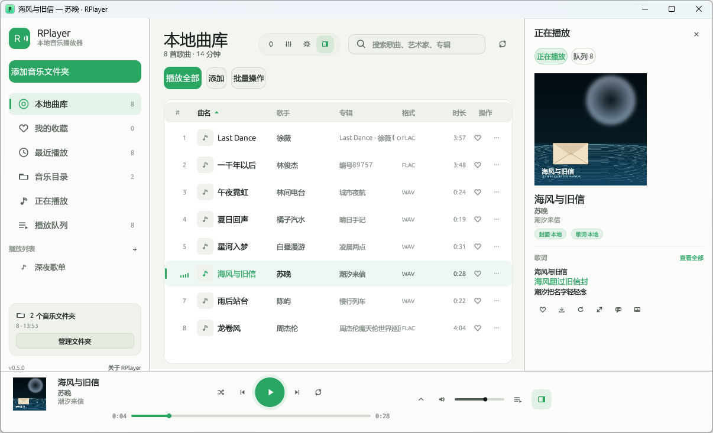
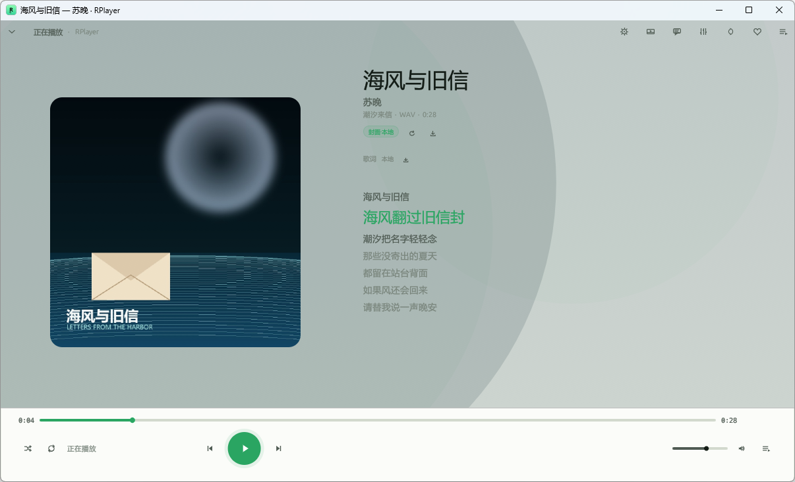
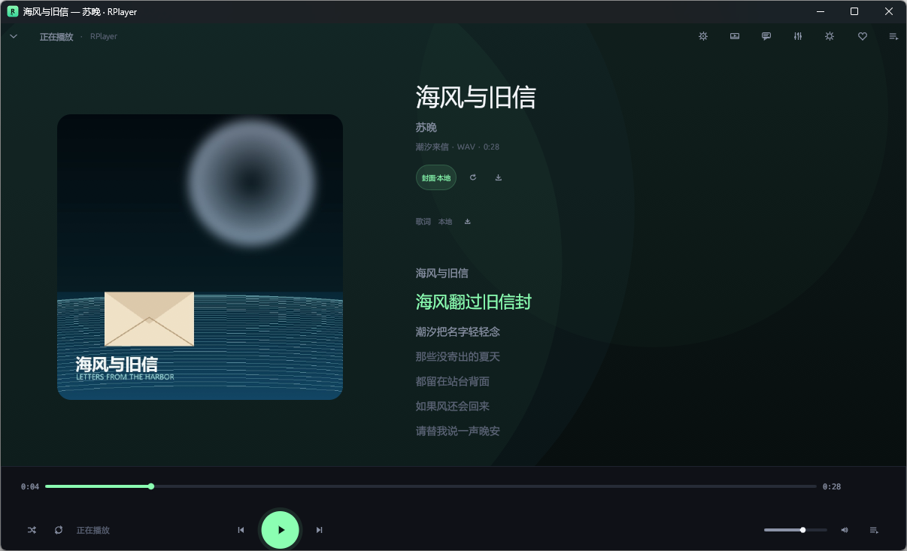
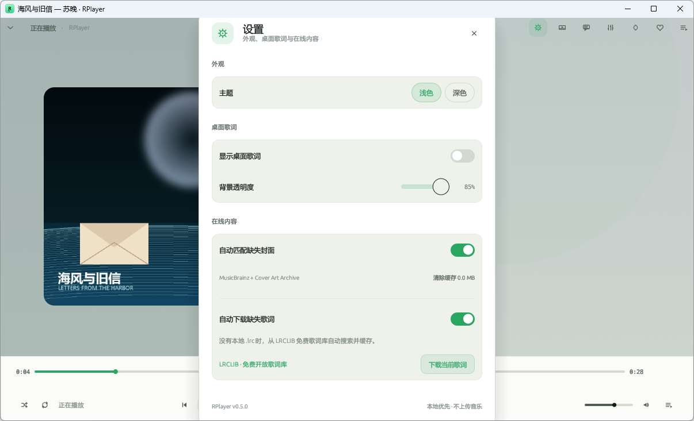

# RPlayer v0.5 界面设计参考与改造说明

| 项目 | 内容 |
| --- | --- |
| 目标 | 让“正在播放”成为可见、可读、可操作的播放器主界面 |
| 参考产品 | Spotify 桌面端、Apple Music（iOS/macOS）、TIDAL/Dribbble 概念稿、LPlayer |
| 当前实现 | RPlayer v0.5 开发中 |
| 相关文档 | [V0.5_PLAN.md](V0.5_PLAN.md) · [REQUIREMENTS.md](REQUIREMENTS.md) |

> 只借用信息架构、排版与交互原则，不复制任何产品的品牌、插画、图标或截图资产。

---

## 1. 调研到的优秀设计

### 1.1 Spotify 桌面端：常驻 Now Playing 侧栏

Spotify 2023 桌面改版把主界面拆成“左侧 Your Library + 中间内容 + 右侧 Now Playing”，并允许在右侧查看当前播放、艺人信息和队列；播放条保持在底部。2024 年 Windows 版进一步把队列移到右侧。

可借鉴的点：

- **播放状态始终可见**，不需要离开曲库就能看封面/歌名/歌词。
- **右侧栏是辅助而非打断**：浏览曲库时仍然能看到当前歌曲。
- **队列靠近 Now Playing**：用户查看“接下来”时不需要跳出当前页面。
- **底部播放条是全局控制**，不随页面变化。

来源：

- [Spotify Newsroom：Desktop redesign](https://newsroom.spotify.com/2023-06-20/spotify-desktop-experience-redesign-your-library-now-playing-views-customize/)
- [WindowsLatest：Spotify 将队列移到右侧](https://www.windowslatest.com/2024/03/17/spotify-on-windows-11-gets-jam-and-moves-queue-to-the-right-side/)

### 1.2 Apple Music：全屏歌词是主角

Apple Music 的 Now Playing 用专辑封面推导背景渐变，进入歌词后封面缩小、歌词占据主视觉；当前行使用更大字重和更高不透明度，相邻行降低透明度，点击任意歌词行可跳转。

这份公开设计规格给出的关键参数：

- 当前歌词：`24pt / 800`，全不透明；
- 相邻行：约 `0.55` 不透明度；
- 再远一行：约 `0.35`；
- 背景：从封面提取主色，饱和度上限约 80%；
- 点击歌词行：seek 到该行时间；
- 歌词是“可读的主内容”，不是封面下方的小字。

来源：[Apple Music iOS Design Spec](https://code.jiangshu.ai/awesome-design-html/assets/ios/design.apple-music-ios.html)（非 Apple 官方文档，基于公开界面整理）。

### 1.3 Dribbble 桌面播放器概念：玻璃层次与聚焦

Dribbble 上的桌面播放器概念稿普遍采用：深色/浅色双主题、玻璃质感浮层、左侧导航、中央内容、右侧播放详情、留白与大字排版。它们适合提供“氛围感”参考，但很多是流媒体发现页，不适合本地曲库的高密度表格。

来源：[Dribbble：Design challenge-009 music player screen](https://dribbble.com/shots/27589869-Design-challenge-009-music-player-screen)

### 1.4 LPlayer：浅色曲库的信息层级

RPlayer 继续保留 LPlayer 风格的浅色曲库：

- 左侧导航 + 大号页面标题；
- 白色圆角曲库卡片；
- 绿色主操作按钮；
- 表格行轻分隔、hover/当前行用淡绿色；
- 底部播放条独立。

v0.5 不推翻这套骨架，只在其上增加“播放详情”层。

---

## 2. 设计决策

### 2.1 三层播放结构

```text
┌──────────────┬──────────────────────────────┬──────────────────┐
│ 左侧导航      │ 曲库 / 收藏 / 歌单 / 目录      │ 正在播放侧栏       │
│              │                              │ 封面/歌词/队列     │
├──────────────┴──────────────────────────────┴──────────────────┤
│ 底部播放条：封面 · 歌名 · 传输控制 · 进度 · 音量 · 桌面歌词/迷你  │
└────────────────────────────────────────────────────────────────┘
```

- **常驻侧栏**：318px，窗口宽度 ≥1200px 时默认显示；更窄时自动隐藏，用底栏按钮/侧栏入口打开。
- **完整播放页**：点击侧栏“正在播放”、底栏封面/标题、`F` 或展开按钮进入。
- **底部播放条**：全局控制，始终存在。

这样同时满足两种使用方式：

- 想边浏览曲库边看歌词 → 右侧栏；
- 想沉浸听歌/读歌词 → 完整播放页。

### 2.2 完整播放页布局

- 左侧约 44%：大封面（210–380px）、歌名、艺术家、专辑、格式/时长、封面来源、收藏/换封面/下载歌词。
- 右侧约 56%：歌词，当前行垂直居中偏上；显示 9 行；点击行 seek。
- 背景：从封面平均色推导的低饱和渐变 + 柔光；无封面时用主题色。
- 底部：进度、播放控制、音量、桌面歌词/迷你/设置。

### 2.3 歌词排版

| 元素 | 规格 |
| --- | --- |
| 当前行 | 22px / 700，强调绿 |
| 相邻行 | 14px / 400，次要文字色 |
| 更远行 | 14px / 400，弱化色 |
| 行距 | 当前行上下 10–12px，普通行 7px |
| 可见行数 | 9 行 |
| 滚动 | 当前行居中；手动滚动后短暂暂停跟随（后续） |
| 跳转 | 点击任意有时间戳的歌词行 seek |
| 来源 | 本地 / 缓存 / LRCLIB，标题旁标记 |

> 参考 Apple Music 的 24pt 当前行；桌面端因信息密度略降为 22px，但仍明显大于相邻行。

### 2.4 封面

- 本地优先级：内嵌 > `<歌曲名>.jpg` > `cover/folder/front.jpg` > 应用缓存 > 在线。
- 在线：MusicBrainz 检索 Release Group，Cover Art Archive 下载；专辑级缓存，避免每首歌重复请求。
- 无封面：使用主题色渐变占位，不显示刺眼的纯灰块；匹配中/未匹配有明确状态。
- 封面来源在播放页用小型 badge 标注：内嵌 / 本地 / 缓存 / 网络。

### 2.5 响应式

| 宽度 | 行为 |
| --- | --- |
| ≥1200 | 左侧导航 + 曲库 + 右侧播放栏 |
| 940–1199 | 右侧栏自动隐藏；底栏/侧栏入口仍可打开完整播放页 |
| <940 | 最小窗口，表格压缩，队列走浮层/完整页 |

---

## 3. 与参考产品的差异

| 参考 | RPlayer 的取舍 |
| --- | --- |
| Spotify 右侧栏信息很多（艺人、巡演、好友） | 只保留封面、歌词、队列，服务本地听歌 |
| Apple Music 全屏歌词是移动端手势 | 桌面端用侧栏/完整页/快捷键，减少模态 |
| Dribbble 概念稿偏流媒体发现 | 保留高密度曲库表格，不牺牲管理效率 |
| LPlayer 浅色卡片 | 保留浅色默认与绿色强调，增加深色与封面氛围 |

---

## 4. 视觉 token（v0.5）

| Token | 浅色 | 深色 |
| --- | --- | --- |
| 页面背景 | `#F6F9F5` | `#0D1411` |
| 侧栏/播放栏 | `#F1F6F0` | `#101915` |
| 卡片 | `#FFFFFF` | `#14201B` |
| 主文字 | `#1D2A23` | `#E8F1EC` |
| 次要文字 | `#66756C` | `#93A69B` |
| 弱化文字 | `#93A198` | `#6E8277` |
| 强调色 | `#2E9E63` | `#5AC58A` |
| 分隔线 | `#E2EBE4` | `#22322A` |

> 具体值以 `src/theme.rs` 为准；本表用于设计评审，不硬编码到组件。

---

## 5. 实现映射

| 设计元素 | 代码 |
| --- | --- |
| 右侧 Now Playing 栏 | `src/app/now_rail.rs` |
| 完整播放页 | `src/app/now_playing.rs` |
| 侧栏“正在播放”入口 | `src/app/sidebar.rs` |
| 底栏封面/标题入口 | `src/app/player_bar.rs` |
| 封面加载/缓存 | `src/cover.rs`、`src/cover_fetch.rs` |
| 歌词来源/跳转 | `src/app/now_playing.rs`、`src/lyrics.rs` |
| 主题 token | `src/theme.rs` |

---

## 6. 待验证

- 1200px 边界：侧栏出现/隐藏时表格列宽是否跳动。
- 125%/150% DPI 下右侧栏封面与歌词是否裁切。
- 无封面/无歌词/下载中/失败四种状态是否都清楚。
- 点击歌词 seek 与拖动进度条是否一致。
- 右侧栏队列拖拽排序是否和底部/完整页一致。
- 浅色下主色背景是否过淡，深色下是否过饱和。

---

## 7. v0.5 实机效果









> 截图使用本地测试音频与测试封面，不包含任何商业音乐平台素材。
